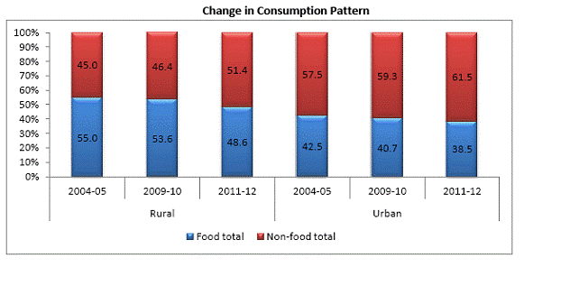
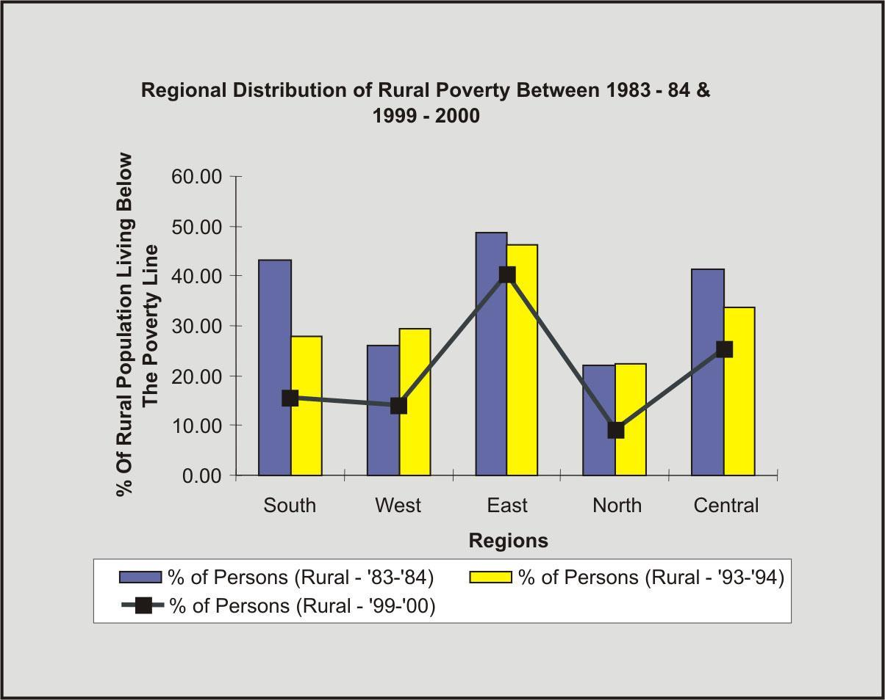
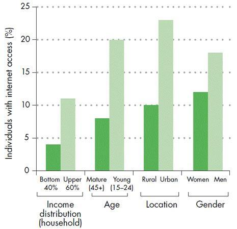
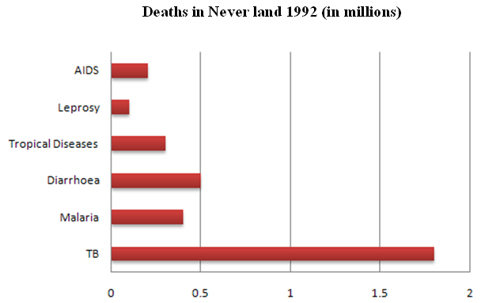
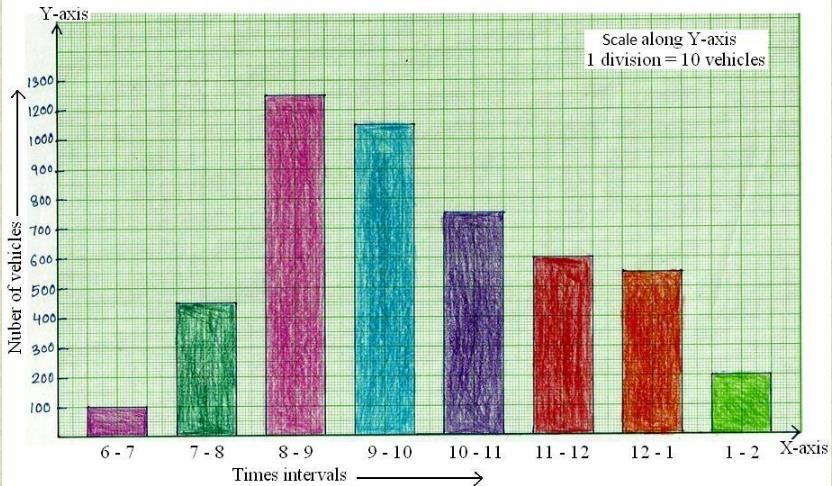

# WP question bank

Generated from the study app data (`study-app/scripts/export-wp-bank.mjs`). Past-paper tasks first, then original practice, grouped in exam order. Model answers are collapsed: try first, then open.

The 3 mock papers are NOT included; keep them for timed practice in the app.

## Contents
- Q1A · Argumentative essay
- Q1B · Paraphrasing
- Q2A · Email
- Q2B · Questionnaire
- Q3A · Interpreting graphs and tables
- Q3B · Summary
- Q4 · Report writing
- Q5A · Parts of an abstract
- Q5B · Grammar correction

## Q1A · Argumentative essay

### From past papers (5)

#### Paper 1: Rumours and social media
_Past paper 1 Q1 · Q1A · 7.5 marks · ~23 min · 150–200 words_

Write an argumentative paragraph in 150-200 on rumours and social media in contemporary times.

Model answer

Social media users and platforms should share responsibility for limiting rumours without suppressing legitimate disagreement. Rapid communication is valuable, but the ease of forwarding information can give unsupported claims an appearance of authority.

First, a rumour may reach many people before anyone checks its origin. Users can reduce this risk by pausing before sharing, checking the date and consulting the original source. A dramatic screenshot is not sufficient evidence simply because a trusted friend has forwarded it. Small acts of verification can interrupt careless repetition.

Second, platforms should make reliable context and correction easier to find. Clear reporting tools and visible explanations for moderation decisions can help users understand why a claim is disputed. Corrections should reach people who encountered the original post where practical.

Critics may fear that these measures will restrict expression. That concern supports transparent rules and an appeal process, rather than allowing every accusation to circulate without scrutiny. Disagreement should remain possible, while fabricated claims should not gain protection merely by being popular. Responsible sharing and accountable platform design can preserve useful communication while reducing the harm caused by unexamined rumours.

**Why it scores:**
- The answer addresses paper 1: rumours and social media directly.
- Details support the requested task and each paragraph has a clear purpose.
- The model follows the requested format with precise, complete sentences.

**Rubric:** Clear thesis and developed reasoning: paper 1: rumours and social media (3.75) · Two arguments, counter-argument and effective rebuttal (1.25) · Logical paragraphs and cohesive conclusion (1.25) · Accurate grammar, punctuation and controlled academic vocabulary (1.25)

#### Paper 2: Social media and cybercrime
_Past paper 2 Q1 · Q1A · 7.5 marks · ~23 min · 150–200 words_

Write an argumentative paragraph in 150-200 words on social media and cybercrime.

Model answer

Social media services should combine user education with effective security measures to reduce cybercrime. These platforms support useful communication, but criminals can exploit trust, personal information and rapid sharing to deceive users.

First, ordinary precautions can reduce avoidable exposure. Users should verify unexpected requests through an independent channel and avoid sharing passwords or one-time codes. A message appearing to come from a familiar account may still be fraudulent. Teaching people to pause and check a request is more practical than assuming that they can recognise every technical trick.

Second, platforms must take responsibility for the systems they operate. Accessible reporting, account protection and clear warnings about suspicious activity can make abuse easier to detect and contain. A victim should have a usable route for seeking assistance.

Some argue that individuals alone should bear the consequences of careless online behaviour. Personal responsibility matters, but it cannot replace responsible service design. Criminals deliberately exploit predictable mistakes, and platforms are better placed to detect repeated patterns. A balanced approach therefore combines informed users with accountable providers. Social media can remain useful while its participants work together to make deception harder and recovery easier.

**Why it scores:**
- The answer addresses paper 2: social media and cybercrime directly.
- Details support the requested task and each paragraph has a clear purpose.
- The model follows the requested format with precise, complete sentences.

**Rubric:** Clear thesis and developed reasoning: paper 2: social media and cybercrime (3.75) · Two arguments, counter-argument and effective rebuttal (1.25) · Logical paragraphs and cohesive conclusion (1.25) · Accurate grammar, punctuation and controlled academic vocabulary (1.25)

#### Paper 3: E-learning achievement
_Past paper 3 Q1 · Q1A · 7.5 marks · ~23 min · 150–200 words_

Write an argumentative paragraph in 150-200 words on the impact of e-learning on students' academic achievement.

Model answer

E-learning can improve academic achievement when it is combined with suitable teaching and reliable access. Its value depends on how it supports learning rather than on the mere presence of a digital platform.

First, recorded explanations and downloadable material allow learners to revisit difficult concepts. A student can pause an example, attempt the steps independently and return to the explanation where understanding breaks down. This flexibility can make revision more purposeful than repeatedly reading incomplete classroom notes.

Second, online tools can provide frequent practice and timely feedback. Short quizzes or draft reviews can reveal misunderstandings before a final assessment. Teachers can then respond to the difficulties actually shown by their students.

However, critics rightly point to unreliable connectivity, distraction and reduced personal contact. These problems can undermine achievement, particularly when institutions assume that every student has the same equipment. Downloadable resources, clear schedules and opportunities for discussion can reduce some of these barriers. E-learning should therefore complement thoughtful teaching rather than be treated as an automatic improvement. With equitable access and active engagement, it can strengthen understanding; without them, it may simply transfer existing difficulties onto a screen.

**Why it scores:**
- The answer addresses paper 3: e-learning achievement directly.
- Details support the requested task and each paragraph has a clear purpose.
- The model follows the requested format with precise, complete sentences.

**Rubric:** Clear thesis and developed reasoning: paper 3: e-learning achievement (3.75) · Two arguments, counter-argument and effective rebuttal (1.25) · Logical paragraphs and cohesive conclusion (1.25) · Accurate grammar, punctuation and controlled academic vocabulary (1.25)

#### Paper 4: Supportive care debate
_Past paper 4 Q1 · Q1A · 7 marks · ~21 min · 200–250 words_

Euthanasia, also known as assisted suicide is defined as the hastening of the death of a patient to prevent further suffering. Passive euthanasia is the practice of intentionally letting a patient die by withholding artificial life support such as a ventilator or feeding tube. Passive euthanasia was made legal in India in March 2018. Should the government fund the supportive care of terminally ill and vegetative patients or is euthanasia the way to go? Write a short argumentative essay in not less than 200 words presenting your opinion.

Model answer

Governments should fund supportive care for terminally ill patients while respecting carefully established decisions about treatment. Financial pressure should not determine whether a person receives comfort, dignity and appropriate assistance. The question should therefore be approached through patient welfare rather than a simple choice between expenditure and death.

First, funded care can reduce the burden on families. A household facing prolonged illness may struggle to obtain nursing support, pain relief and clear advice. Public provision can make these services more accessible and prevent lack of money from becoming the decisive consideration. Support should address both the patient's needs and the practical demands placed on caregivers.

Second, humane care requires attention to individual wishes and clinical circumstances. Terminal illness and a vegetative state are not interchangeable descriptions. Decisions about treatment should involve appropriate expertise, careful communication and respect for the patient's expressed preferences. An essay should not assume that every case has the same prognosis or desired outcome.

Critics may argue that limited public resources should be directed only towards curable conditions. Resource allocation is a real challenge, but relief of suffering remains a legitimate purpose of healthcare. Proportionate supportive services can protect dignity without assuming that every possible intervention must continue indefinitely.

Government funding should therefore make meaningful care available while allowing difficult decisions to follow the relevant safeguards. Compassion is better served by informed choices and accessible support than by presenting vulnerable patients or their families with a financially forced alternative.

**Why it scores:**
- The answer addresses paper 4: supportive care debate directly.
- Details support the requested task and each paragraph has a clear purpose.
- The model follows the requested format with precise, complete sentences.

**Rubric:** Clear thesis and developed reasoning: paper 4: supportive care debate (3.5) · Two arguments, counter-argument and effective rebuttal (1.1666666666666667) · Logical paragraphs and cohesive conclusion (1.1666666666666667) · Accurate grammar, punctuation and controlled academic vocabulary (1.1666666666666667)

#### Paper 5: Offline exams after online classes
_Past paper 5 Q1 · Q1A · 7 marks · ~21 min · 200–250 words_

Write a short argumentative essay in not less than 200 words expressing your opinion on whether it was fair for educational institutions to conduct exams in the offline mode while the classes were conducted online during the Lockdown.

Model answer

Conducting compulsory offline examinations after entirely online classes during lockdown was unfair where institutions failed to address students’ unequal circumstances. An assessment may be academically demanding, but it should also provide a reasonable opportunity for students to demonstrate learning.

First, online teaching did not guarantee equal preparation. Some students had quiet rooms, dependable devices and reliable connections; others struggled to join classes consistently. A common examination could therefore reflect differences in access as well as differences in understanding. Institutions needed to identify and respond to these barriers before deciding on an assessment format.

Second, travelling to an examination centre could create additional difficulty during a disrupted period. Students living far away or facing family responsibilities required clear notice and workable arrangements. A sudden change of mode could place burdens on those least able to absorb them. Fairness required consultation, accessible information and appropriate alternatives.

Supporters of offline examinations may argue that supervision improves confidence in independent work. That concern is reasonable. However, academic integrity can be addressed through suitable assessment design, oral follow-up or carefully organised alternatives. It does not justify ignoring access and travel difficulties.

Offline assessment was therefore defensible only when practical safeguards and adequate preparation accompanied it. Institutions should have matched their expectations with the learning conditions students actually experienced. The fairest response would preserve academic standards while ensuring that the method of assessment did not create avoidable disadvantages unrelated to the knowledge being tested.

**Why it scores:**
- The answer addresses paper 5: offline exams after online classes directly.
- Details support the requested task and each paragraph has a clear purpose.
- The model follows the requested format with precise, complete sentences.

**Rubric:** Clear thesis and developed reasoning: paper 5: offline exams after online classes (3.5) · Two arguments, counter-argument and effective rebuttal (1.1666666666666667) · Logical paragraphs and cohesive conclusion (1.1666666666666667) · Accurate grammar, punctuation and controlled academic vocabulary (1.1666666666666667)

### Practice (6)

#### AI as a learning aid
_Original practice · Q1A · 6 marks · ~18 min · 250 words_

Should universities allow students to use AI tools while preparing assignments? Write a 250-word argumentative essay.

Model answer

Universities should permit AI tools during assignment preparation when students disclose their use and remain responsible for the submitted work. A blanket ban would overlook learning support, while unrestricted use would weaken assessment. Clear boundaries offer a educational response.

First, AI can make difficult material easier to approach. A student who cannot follow a textbook explanation may request a simpler example and then test that explanation against course notes. This process can support independent learning, particularly outside classroom hours. However, students must verify generated claims because fluent language does not guarantee accuracy.

Second, supervised use can develop the judgement needed in professional work. Asking students to compare an AI draft with reliable material encourages them to identify unsupported statements, biased assumptions and weak reasoning. Requiring a brief account of revisions also makes their own contribution visible to teachers.

Critics reasonably argue that students may submit generated answers without understanding them. This risk deserves attention, but prohibition alone cannot demonstrate understanding. Short oral explanations, intermediate drafts and questions about individual choices provide better evidence of learning. Assessments should therefore reward reasoning and revision alongside the final product.

Universities should distinguish assistance from substitution. Students may use tools to explore ideas or receive language feedback, but they should construct and defend the argument themselves. With disclosure, verification and appropriate assessment, AI can become a learning aid rather than a shortcut. The central objective should remain the development of informed writers who can explain both what they claim and why they believe it.

**Why it scores:**
- The opening takes a qualified but definite position.
- Two body paragraphs develop distinct reasons with concrete examples.
- The counter-argument receives a practical rebuttal; the conclusion returns to the thesis without invented statistics.

**Rubric:** Clear thesis and developed reasoning: ai as a learning aid (3) · Two arguments, counter-argument and effective rebuttal (1) · Logical paragraphs and cohesive conclusion (1) · Accurate grammar, punctuation and controlled academic vocabulary (1)

#### Flexible work
_Original practice · Q1A · 6 marks · ~18 min · 250 words_

Should employers offer hybrid working wherever the job allows it? Write a 250-word argumentative essay.

Model answer

Employers should offer hybrid working when duties can be performed effectively away from the office. An organised arrangement can improve employees' control over their time while preserving the collaboration that workplaces need. Flexibility should depend on the work, rather than managerial habit.

First, fewer compulsory journeys can make the working day more manageable. An employee who avoids a commute has more time for rest or family responsibilities. This does not automatically produce better performance, but it removes a predictable source of fatigue. Teams can assess results through completed work instead of assuming that visible attendance proves commitment.

Second, office days can make collaboration more purposeful. A team might meet for project planning, practical training and difficult decisions, while completing concentrated individual tasks elsewhere. Publishing attendance days would help employees coordinate without requiring everyone to travel merely to join online meetings from separate desks.

Opponents argue that remote work can isolate new employees and delay informal learning. These concerns are valid, especially during induction. They support mentoring and office attendance, however, rather than an identical rule for every role. New staff could attend more frequently until they become confident in their responsibilities.

Hybrid working also requires clear availability, secure information handling and accessible equipment. Employers should review arrangements with staff and adjust them when service suffers. Overall, a flexible system with expectations offers a fair balance between autonomy and teamwork. Its success should be judged by reliable delivery, effective cooperation and employee experience, with arrangements revised whenever the evidence shows difficulties.

**Why it scores:**
- The opening takes a qualified but definite position.
- Two body paragraphs develop distinct reasons with concrete examples.
- The counter-argument receives a practical rebuttal; the conclusion returns to the thesis without invented statistics.

**Rubric:** Clear thesis and developed reasoning: flexible work (3) · Two arguments, counter-argument and effective rebuttal (1) · Logical paragraphs and cohesive conclusion (1) · Accurate grammar, punctuation and controlled academic vocabulary (1)

#### Refill stations
_Original practice · Q1A · 6 marks · ~18 min · 250 words_

Should colleges replace disposable water bottles with refill stations? Write a 250-word argumentative essay.

Model answer

Colleges should make safe refill stations the normal source of drinking water and reduce dependence on disposable bottles. This change can address waste while making drinking water more accessible. It should be introduced with maintenance and contingency plans rather than as a symbolic ban.

First, refill stations prevent waste at its source. Recycling still requires collection, transport and processing, and a bottle placed in the wrong bin may never reach a recycling facility. A student who repeatedly fills the same container avoids producing many discarded containers. The campus can reinforce this habit by placing stations near classrooms and shared spaces.

Second, a free supply can reduce spending. Students should not need to purchase packaged water simply because a lecture block lacks a working tap. Labelled stations, accessible heights and published maintenance contacts would make the service useful to a wider range of users, including visitors.

Critics may point out that poorly maintained dispensers create hygiene concerns. That objection is serious, but it argues for testing and accountability rather than permanent reliance on packaging. The college should assign responsibility for cleaning, record inspections and provide an alternative supply during interruptions. Users should also receive clear information about any closure.

The transition should therefore begin with reliable infrastructure and consultation. Emergency supplies can remain available without making disposable bottles the default. By measuring station reliability and waste collected, colleges can judge progress honestly. A practical refill system combines environmental responsibility with student welfare and turns an abstract commitment into an everyday service.

**Why it scores:**
- The opening takes a qualified but definite position.
- Two body paragraphs develop distinct reasons with concrete examples.
- The counter-argument receives a practical rebuttal; the conclusion returns to the thesis without invented statistics.

**Rubric:** Clear thesis and developed reasoning: refill stations (3) · Two arguments, counter-argument and effective rebuttal (1) · Logical paragraphs and cohesive conclusion (1) · Accurate grammar, punctuation and controlled academic vocabulary (1)

#### Sleep and assessment
_Original practice · Q1A · 6 marks · ~18 min · 250 words_

Should schools avoid scheduling major tests very early in the morning? Write a 250-word argumentative essay.

Model answer

Schools should avoid placing tests early in the morning whenever a workable later schedule is available. Assessment should measure understanding as as possible, and its timing can affect students' ability to demonstrate what they know. Convenience should be balanced against readiness to learn.

First, an early test may compound unequal travel demands. Some pupils live near school, while others must leave home much earlier because of bus routes. A demanding examination immediately after arrival gives the second group little opportunity to settle. A later session allows time for classroom routines before concentrated assessment begins.

Second, scheduling can support preparation without encouraging unhealthy habits. Schools can communicate a predictable timetable and discourage studying through the night. Students still have responsibility for managing their time, but institutional arrangements should reinforce that responsibility. A schedule that allows breakfast and an orderly journey supports a more examination experience.

Opponents may argue that early tests leave the rest of the day free and simplify staffing. These are administrative benefits. Nevertheless, rotating examination sessions or adjusting a number of major test days may preserve those benefits while improving fairness. Schools should discuss constraints before choosing a consistent policy.

Timing alone cannot remove anxiety, poor preparation or differences in achievement. It is one adjustable part of assessment design. Schools should review attendance, student feedback and transport arrangements before making changes. Where later testing is feasible, it offers a but useful way to align assessment with student welfare while retaining demanding academic standards for everyone taking the examination.

**Why it scores:**
- The opening takes a qualified but definite position.
- Two body paragraphs develop distinct reasons with concrete examples.
- The counter-argument receives a practical rebuttal; the conclusion returns to the thesis without invented statistics.

**Rubric:** Clear thesis and developed reasoning: sleep and assessment (3) · Two arguments, counter-argument and effective rebuttal (1) · Logical paragraphs and cohesive conclusion (1) · Accurate grammar, punctuation and controlled academic vocabulary (1)

#### Peer tutoring
_Original practice · Q1A · 6 marks · ~18 min · 250 words_

Should universities provide organised peer tutoring alongside lectures? Write a 250-word argumentative essay.

Model answer

Universities should provide peer tutoring alongside lectures because it can extend opportunities to practise and clarify difficult ideas. Such support should complement teaching and remain accessible to students who need it. Its value depends on preparation, supervision and clear limits.

First, a fellow student may recognise the difficulty that a beginner faces. Someone who learnt a programming concept can explain the intermediate steps that an lecturer may assume are obvious. Small tutoring sessions also allow learners to ask questions they might hesitate to raise in a classroom. The tutor benefits by having to explain the reasoning clearly.

Second, a scheme can make support more equitable. Without an organised service, students with friendship networks may obtain help more easily than others. Published session times, accessible rooms and an online booking option can reduce that difference. Participation should be voluntary, with arrangements for learners whose employment or caring responsibilities restrict attendance.

Critics rightly warn that peers may pass on errors or simply provide assignment answers. The solution is to train tutors, supply approved practice material and establish referral routes to teachers. Tutors should guide the learner through a method rather than complete assessed work. Periodic observation can identify explanations that need correction.

Peer tutoring cannot replace adequate staffing or resolve every learning difficulty. It can, however, create a bridge between lectures and independent study. Universities should pilot the scheme, collect feedback and revise it. With oversight, peer support can strengthen both academic understanding and a sense of belonging within the university community.

**Why it scores:**
- The opening takes a qualified but definite position.
- Two body paragraphs develop distinct reasons with concrete examples.
- The counter-argument receives a practical rebuttal; the conclusion returns to the thesis without invented statistics.

**Rubric:** Clear thesis and developed reasoning: peer tutoring (3) · Two arguments, counter-argument and effective rebuttal (1) · Logical paragraphs and cohesive conclusion (1) · Accurate grammar, punctuation and controlled academic vocabulary (1)

#### Digital services and access
_Original practice · Q1A · 6 marks · ~18 min · 250 words_

Should essential public services retain an assisted offline option? Write a 250-word argumentative essay.

Model answer

Public services should retain an assisted offline option while expanding digital access. Online systems can save time, but access to a service should not depend on owning a device or navigating a website. Inclusion requires more than placing a form online.

First, digital ability and resources vary. A person may have a phone but lack connectivity, accessible software or confidence in completing an unfamiliar application. Errors can delay support precisely when it is most needed. An assistance desk or scheduled telephone service can help users complete the same process without forcing them to rely on intermediaries.

Second, an alternative channel improves resilience. A failed network connection or inaccessible verification screen should not prevent a time-sensitive request from being recorded. Staff should have a procedure for acknowledging applications during interruptions. This creates a route for resolving problems rather than leaving users to attempt a failed transaction.

Opponents argue that maintaining several channels increases costs and duplicates work. That concern deserves a practical response. Assisted applications can enter the same administrative system as online submissions, while appointments and targeted support can manage demand. The alternative need not reproduce every office process in full.

Digital expansion remains worthwhile when it simplifies tasks. Its success, however, should include successful completion by people facing access barriers. Authorities should publish assistance arrangements and review where users abandon applications. A coordinated combination of online convenience and human support offers a fairer service, allowing technical progress to widen participation without making essential help depend on digital confidence alone.

**Why it scores:**
- The opening takes a qualified but definite position.
- Two body paragraphs develop distinct reasons with concrete examples.
- The counter-argument receives a practical rebuttal; the conclusion returns to the thesis without invented statistics.

**Rubric:** Clear thesis and developed reasoning: digital services and access (3) · Two arguments, counter-argument and effective rebuttal (1) · Logical paragraphs and cohesive conclusion (1) · Accurate grammar, punctuation and controlled academic vocabulary (1)

## Q1B · Paraphrasing

### From past papers (8)

#### Paper 1: Paraphrase 2
_Past paper 1 Q2 · Q1B · 5 marks · ~15 min · 98–120 words_

Paraphrase the following paragraph. Avoid using words and phrases from the original text as far as possible.

> South Asia refers to the nation-states of Bangladesh, Bhutan, India, the Maldives, Nepal, Pakistan, Sri Lanka, and Tibet. "South Asia" as a constructed category is often used as a strategic geopolitical or geographical term indicating political alliances, both in Asia and the diasporas, and the term is one that can configure social identities and categories without necessarily alluding to national identities. It is not to be taken as a term designating an object of study, as does area studies, but rather as designating a constructed geopolitical region with interlinked political economies and histories, a subject of study. Nevertheless, it is important to recognize the ambivalent function of the term. (Adapted from Desai, 2003, p. 5)

Model answer

Bangladesh, Bhutan, India, the Maldives, Nepal, Pakistan, Sri Lanka and Tibet are included in the source’s account of South Asia. The label is frequently employed to construct a geographical or strategic political grouping, expressing alliances within Asia and among communities abroad. It may also shape social classifications without directly referring to nationality. Rather than simply identifying a conventional area-studies object, the term frames an interconnected region whose economies, political relationships and histories can be examined together. Its role is nevertheless uncertain and potentially contradictory, so the category should not be accepted as having a single straightforward meaning.

**Why it scores:**
- The answer addresses paper 1: paraphrase 2 directly.
- Details support the requested task and each paragraph has a clear purpose.
- The model follows the requested format with precise, complete sentences.

**Rubric:** All source meanings and qualifications retained: paper 1: paraphrase 2 (2.5) · Independent sentence structures and word forms (1.25) · Appropriate vocabulary with technical terms intact (0.625) · Accurate grammar and approximately the source length (0.625)

#### Paper 1: Paraphrase 3
_Past paper 1 Q3 · Q1B · 5 marks · ~15 min · 97–119 words_

Paraphrase the following paragraph. Avoid using words and phrases from the original text as far as possible.

> Entanglement lay at the heart of a fiery clash in the 1930s between physics titans Albert Einstein on the one hand and Niels Bohr and Erwin Schrödinger on the other about how the universe operates at a fundamental level. Einstein believed all aspects of reality should have a concrete and fully knowable existence. All objects -- from the moon to a photon of light -- should have precisely defined properties that can be discovered through measurement. Bohr, Schrödinger and other proponents of the nascent quantum mechanics, however, were finding that reality appeared to be fundamentally uncertain; a particle does not possess certain properties until the moment of measurement. (Wood, 2022)

Model answer

During the 1930s, quantum entanglement became central to a heated disagreement involving Einstein, Bohr and Schrödinger over the basic character of the universe. For Einstein, reality had to exist in a definite form that could, in principle, be completely understood. Whether considering the moon or a light particle, he expected objects to possess specific characteristics discoverable by observation. By contrast, the emerging quantum account supported by Bohr, Schrödinger and others suggested unavoidable uncertainty. In that view, some features of a particle become determinate only when it is measured, rather than existing as fixed properties beforehand.

**Why it scores:**
- The answer addresses paper 1: paraphrase 3 directly.
- Details support the requested task and each paragraph has a clear purpose.
- The model follows the requested format with precise, complete sentences.

**Rubric:** All source meanings and qualifications retained: paper 1: paraphrase 3 (2.5) · Independent sentence structures and word forms (1.25) · Appropriate vocabulary with technical terms intact (0.625) · Accurate grammar and approximately the source length (0.625)

#### Paper 2: Paraphrase 2
_Past paper 2 Q2 · Q1B · 5 marks · ~15 min · 93–113 words_

Paraphrase the following paragraph. Avoid using words and phrases from the original text as far as possible.

> Recently, inkless printing has attracted much attention because of the lower environmental impact. Inkless technology is a new revolutionary step in the history of printing technologies. Similar to inkless printing, inkless writing is also important in terms of environmental pollution. The inks used for writing contain toxic and harmful chemicals; they are not safe for human health and the environment. The information written by ink on paper is permanent, and most of the time it cannot be erased; this creates vast problems of paper waste and forest conservation. Therefore, it is important to search for a green solution for the replacement of ink.

Model answer

Printing without ink has recently drawn considerable interest as a less environmentally damaging technology and represents a major development in printing methods. The same environmental argument applies to writing. Conventional writing fluids include substances that can endanger people and the natural world. Moreover, marks made with ink usually remain on the page and cannot readily be removed. This permanence contributes to discarded paper and creates difficulties for protecting forests. An environmentally responsible substitute for ink is consequently worth investigating, so that the effects of writing, as well as those of printing, can be reduced.

**Why it scores:**
- The answer addresses paper 2: paraphrase 2 directly.
- Details support the requested task and each paragraph has a clear purpose.
- The model follows the requested format with precise, complete sentences.

**Rubric:** All source meanings and qualifications retained: paper 2: paraphrase 2 (2.5) · Independent sentence structures and word forms (1.25) · Appropriate vocabulary with technical terms intact (0.625) · Accurate grammar and approximately the source length (0.625)

#### Paper 2: Paraphrase 3
_Past paper 2 Q3 · Q1B · 5 marks · ~15 min · 68–82 words_

Paraphrase the following paragraph. Avoid using words and phrases from the original text as far as possible.

> I learnt something from that fantastic singer, Frank Sinatra, who wrote a little article many years ago in Time magazine, where he said that if you use your microphone as your lover, you will know exactly how to control your voice. Because, if you've got to say something loving, you just bring it closer. Every time you've got to say something powerful, you just take it far away. All these things only come through experience.

Model answer

An article that Frank Sinatra published in Time years ago taught me a useful lesson about singing. He suggested treating the microphone as though it were a loved one in order to regulate the voice precisely. A gentle, affectionate phrase calls for bringing it nearer, whereas a forceful passage requires moving it farther away. Learning to manage these adjustments depends on practical experience rather than merely knowing the advice. The skilled singer develops control by discovering when closeness or distance best serves the expression of the performance.

**Why it scores:**
- The answer addresses paper 2: paraphrase 3 directly.
- Details support the requested task and each paragraph has a clear purpose.
- The model follows the requested format with precise, complete sentences.

**Rubric:** All source meanings and qualifications retained: paper 2: paraphrase 3 (2.5) · Independent sentence structures and word forms (1.25) · Appropriate vocabulary with technical terms intact (0.625) · Accurate grammar and approximately the source length (0.625)

#### Paper 3: Paraphrase 2
_Past paper 3 Q2 · Q1B · 5 marks · ~15 min · 105–129 words_

Paraphrase the following paragraph. Avoid using words and phrases from the original text as far as possible.

> Several research studies on metal contamination of surface water, groundwater and rainwater have reported high levels of metals. This review article focuses on the contamination of waters in sub- Saharan Africa by cadmium, lead, mercury and arsenic, because of their toxicity and the health and ecotoxicological consequences linked to their presence in water. These are heavy metals at the origin of several dangerous diseases such as lead poisoning, hydrarygysmus, Itai Itai disease, etc. This article reviews the problems of accessibility to drinking water in communities in terms of quantity and quality, the origins and levels of water contamination by metals as well as analytical methods for metals and the consequences related to the consumption of these waters. (Adapted from Abdou et al., 2023, p. 1)

Model answer

Research into pollution in rivers and other surface sources, underground supplies and rainfall has repeatedly identified substantial metal concentrations. This review examines cadmium, lead, mercury and arsenic in sub-Saharan African waters because these substances are poisonous and affect both human health and ecosystems. Exposure is associated with serious illnesses, including lead poisoning, mercury poisoning and Itai Itai disease. The article considers whether communities can obtain enough safe drinking water, where metal pollution originates and how extensive it is. It also examines techniques for detecting these contaminants and the effects of consuming affected water, bringing together questions of supply, measurement and harm.

**Why it scores:**
- The answer addresses paper 3: paraphrase 2 directly.
- Details support the requested task and each paragraph has a clear purpose.
- The model follows the requested format with precise, complete sentences.

**Rubric:** All source meanings and qualifications retained: paper 3: paraphrase 2 (2.5) · Independent sentence structures and word forms (1.25) · Appropriate vocabulary with technical terms intact (0.625) · Accurate grammar and approximately the source length (0.625)

#### Paper 3: Paraphrase 3
_Past paper 3 Q3 · Q1B · 5 marks · ~15 min · 123–151 words_

Paraphrase the following paragraph. Avoid using words and phrases from the original text as far as possible.

> The AI chatbot ChatGPT has brought the capabilities of such tools, known as LLMs, to a mass audience. ChatGPT can write presentable student essays, summarize research papers, answer questions well enough to pass medical exams and generate helpful computer code. It has produced research abstracts good enough that scientists found it hard to spot that a computer had written them. "Worryingly for society, it could also make spam, ransomware and other malicious outputs easier to produce. Although OpenAI has tried to put guard rails on what the chatbot will do, users are already finding ways around them," said the report. That is why Nature is setting out these principles. "Ultimately, research must have transparency in methods, and integrity and truth from authors. This is, after all, the foundation that science relies on to advance," the report mentioned. (Published in The Economic Times, 27th January, 2023)

Model answer

ChatGPT introduced a broad public to the abilities of large language models. Such systems can produce readable academic essays, condense scientific articles, generate useful programs and answer questions at a level sufficient for medical examinations. Their research summaries have even made it difficult for scientists to recognise computer authorship. The report also warned that these capabilities could simplify the creation of unwanted messages, ransomware and other harmful material. Although the developer had introduced restrictions, users were already discovering ways to evade them. Nature therefore outlined principles for using these tools. The report stressed that scientific progress depends on honest authorship, accurate claims and openness about research procedures. These foundations must remain central even when automated writing becomes convincing and widely available.

**Why it scores:**
- The answer addresses paper 3: paraphrase 3 directly.
- Details support the requested task and each paragraph has a clear purpose.
- The model follows the requested format with precise, complete sentences.

**Rubric:** All source meanings and qualifications retained: paper 3: paraphrase 3 (2.5) · Independent sentence structures and word forms (1.25) · Appropriate vocabulary with technical terms intact (0.625) · Accurate grammar and approximately the source length (0.625)

#### Paper 4: Paraphrase 2
_Past paper 4 Q2 · Q1B · 6 marks · ~18 min · 162–198 words_

Paraphrase the following paragraph. Avoid using words and phrases from the original text as far as possible.

> Sunset is the time when the sun goes down and night begins. During the sunset, nature assumes fresh, bright, and charming. The sun seems to be a disc of gold. We discover an excellent show of colors within the western sky. Seven colors make the western sky look charming. The full earth and also the sky seem to be painted with colors. The golden rays of the setting sun fall on the water of ponds, rivers, on top of trees. The western horizon appears exquisitely beautiful. The sky is then covered with the red glow of the setting sun, and all the objects of nature put on an alarming appearance. The ripples of the rivers look purple within the red glow of the departing sun. Gradually, the sun sinks below the horizon, and also the red tinge of the sky begins to turn. Darkness then covers the entire earth. The cowboys return home with their cattle. Birds are seen flying back to their nests. Nothing but some stars are seen within the western sky. A sunset scene is basically enjoyable.

Model answer

Evening begins as the sun descends and daylight gives way to night. At this moment, the natural world takes on a renewed brilliance. The sun resembles a golden circle, while a striking range of colours spreads across the western heavens. The sky and land appear washed in many shades. Light from the sinking sun touches rivers, ponds and treetops, making the distant western edge especially attractive. A reddish glow fills the sky and changes the appearance of surrounding objects. Beneath that light, the river’s small waves seem purple. As the sun finally passes out of view, the red colouring gradually fades. Darkness then extends over the landscape. People tending cattle lead their animals home, and birds make their way towards their nests. Eventually, only a few stars remain visible in the western sky. Watching this transition from vivid evening light to darkness offers a pleasing experience, bringing together changing colours, movement and the quiet return of living creatures to shelter.

**Why it scores:**
- The answer addresses paper 4: paraphrase 2 directly.
- Details support the requested task and each paragraph has a clear purpose.
- The model follows the requested format with precise, complete sentences.

**Rubric:** All source meanings and qualifications retained: paper 4: paraphrase 2 (3) · Independent sentence structures and word forms (1.5) · Appropriate vocabulary with technical terms intact (0.75) · Accurate grammar and approximately the source length (0.75)

#### Paper 5: Paraphrase 2
_Past paper 5 Q2 · Q1B · 6 marks · ~18 min · 118–144 words_

Paraphrase the following paragraph. Avoid using words and phrases from the original text as far as possible.

> Nature is the ultimate source of our living. Both living and non-living things include nature, and everyone is interdependent, which helps maintain the ecosystem. Plants, animals, and humans all depend on nature for their survival. It supplies oxygen, sunlight, soil, water, and other necessary components. But deforestation has been the primary cause of global warming, destroying nature. In addition to exploiting excessive natural resources, other industries pollute the environment with toxic gases and chemicals. It is now essential to reduce biological damage, reuse things, and recycle existing materials to create new ones. People from all over the world should join forces to relieve pressure on the environment and restore its balance. It is now the essential aim to serve nature with utmost care to save our nature from hazards and threats.

Model answer

The natural world makes life possible through the connections among its living and non-living elements. People, animals and plants depend on this system for air, light, land, water and other essentials. Clearing forests has contributed greatly to rising global temperatures and damage to the environment. Industrial activity adds further pressure by consuming too many resources and releasing dangerous chemicals and gases. Reducing harm now requires using fewer materials, putting existing items to further use and turning discarded products into new ones. Cooperation across countries is needed to ease these pressures and recover ecological stability. Protecting the environment carefully has therefore become an urgent shared responsibility if its essential systems are to survive continuing threats.

**Why it scores:**
- The answer addresses paper 5: paraphrase 2 directly.
- Details support the requested task and each paragraph has a clear purpose.
- The model follows the requested format with precise, complete sentences.

**Rubric:** All source meanings and qualifications retained: paper 5: paraphrase 2 (3) · Independent sentence structures and word forms (1.5) · Appropriate vocabulary with technical terms intact (0.75) · Accurate grammar and approximately the source length (0.75)

### Practice (6)

#### Offline learning access
_Original practice · Q1B · 4 marks · ~12 min · 64–78 words_

Paraphrase the paragraph. Preserve its meaning and approximate length. Change vocabulary and sentence structure without adding claims.

> A college uploaded all its reading material to a digital portal. Students could download chapters before travelling and study without a continuous internet connection. However, several scanned documents were incompatible with screen readers. The library therefore began replacing these files with accessible versions. Staff also provided a short guide explaining how to locate and download the readings. The change improved access only when both the documents and the instructions were usable.

Model answer

By placing its course readings on an online platform, the college enabled learners to save chapters in advance and read them while disconnected. Access nevertheless remained difficult for users of screen-reading software because some scans could not be interpreted. Librarians responded by preparing compatible files and offering brief instructions for finding and saving them. Thus, the initiative made study easier only where learners could use both the material itself and the guidance supplied.

**Why it scores:**
- The answer addresses the stated procedure, purpose and qualifications directly.
- Details support the requested task and each paragraph has a clear purpose.
- The model follows the requested format with precise, complete sentences.

**Rubric:** All source meanings and qualifications retained: the stated procedure, purpose and qualifications (2) · Independent sentence structures and word forms (1) · Appropriate vocabulary with technical terms intact (0.5) · Accurate grammar and approximately the source length (0.5)

#### Repair before replacement
_Original practice · Q1B · 4 marks · ~12 min · 64–78 words_

Paraphrase the paragraph. Preserve its meaning and approximate length. Change vocabulary and sentence structure without adding claims.

> An office introduced a repair service for damaged keyboards and monitors. Employees were asked to report faults before requesting new equipment. Technicians recorded the cause of each failure and the cost of repair. Equipment that could not be repaired safely was replaced. After three months, the records helped managers identify recurring faults and plan purchases more carefully. The service was intended to reduce unnecessary disposal without keeping unreliable devices in use.

Model answer

To avoid discarding equipment unnecessarily, an organisation arranged for faulty displays and keyboards to be inspected and fixed. Staff first had to notify technicians of a problem rather than immediately seek a replacement. For every case, the team documented why the device failed and what restoration cost. Unsafe items beyond repair were exchanged. Three months of records then enabled management to recognise repeated defects and make better purchasing decisions, while ensuring that dependable equipment remained available.

**Why it scores:**
- The answer addresses the stated procedure, purpose and qualifications directly.
- Details support the requested task and each paragraph has a clear purpose.
- The model follows the requested format with precise, complete sentences.

**Rubric:** All source meanings and qualifications retained: the stated procedure, purpose and qualifications (2) · Independent sentence structures and word forms (1) · Appropriate vocabulary with technical terms intact (0.5) · Accurate grammar and approximately the source length (0.5)

#### Cooling a campus
_Original practice · Q1B · 4 marks · ~12 min · 68–82 words_

Paraphrase the paragraph. Preserve its meaning and approximate length. Change vocabulary and sentence structure without adding claims.

> Trees can make outdoor campus spaces more comfortable by providing shade. Their effects depend on their location, size and suitability for the local climate. Planting alone is insufficient if young trees receive no water or protection. A campus gardening team therefore mapped exposed pedestrian routes before choosing planting sites. It also assigned responsibility for maintaining each site. The project treated long-term care as part of the planting process rather than as an optional later activity.

Model answer

Shade from trees can improve comfort in open university areas, although the benefit varies with placement, growth and adaptation to local conditions. New planting will achieve little without adequate watering and protection. Before selecting sites, the gardening group identified walking routes exposed to the sun and allocated maintenance duties for each location. Ongoing care was consequently included in the project from the beginning, instead of being left as a discretionary task after planting was complete.

**Why it scores:**
- The answer addresses the stated procedure, purpose and qualifications directly.
- Details support the requested task and each paragraph has a clear purpose.
- The model follows the requested format with precise, complete sentences.

**Rubric:** All source meanings and qualifications retained: the stated procedure, purpose and qualifications (2) · Independent sentence structures and word forms (1) · Appropriate vocabulary with technical terms intact (0.5) · Accurate grammar and approximately the source length (0.5)

#### Appointment reminders
_Original practice · Q1B · 4 marks · ~12 min · 70–86 words_

Paraphrase the paragraph. Preserve its meaning and approximate length. Change vocabulary and sentence structure without adding claims.

> A clinic sent appointment reminders by text message to patients who had agreed to receive them. Each message included the appointment time and a number for rescheduling. Patients were not asked to send medical information in reply. Staff continued to telephone people who preferred not to use text messages. The clinic evaluated the service by checking delivery failures and asking patients whether the reminders were clear. It did not assume that a delivered message had necessarily been read.

Model answer

Patients who consented received text notifications from a clinic stating when they were due and how to arrange another time. Replies containing health details were not requested. Telephone reminders remained available to those who did not want texts. To assess the scheme, employees examined unsuccessful deliveries and sought feedback on how understandable the notices were. Receipt by a device was therefore distinguished from actual reading by its owner when the service was evaluated.

**Why it scores:**
- The answer addresses the stated procedure, purpose and qualifications directly.
- Details support the requested task and each paragraph has a clear purpose.
- The model follows the requested format with precise, complete sentences.

**Rubric:** All source meanings and qualifications retained: the stated procedure, purpose and qualifications (2) · Independent sentence structures and word forms (1) · Appropriate vocabulary with technical terms intact (0.5) · Accurate grammar and approximately the source length (0.5)

#### Workplace focus
_Original practice · Q1B · 4 marks · ~12 min · 69–85 words_

Paraphrase the paragraph. Preserve its meaning and approximate length. Change vocabulary and sentence structure without adding claims.

> A design team reserved two afternoons each week for work without routine meetings. Urgent messages could still be sent through an agreed channel. Team members used the protected periods for tasks requiring sustained attention. The arrangement did not remove the need for discussion; instead, regular meetings were moved to other times. After a month, the team reviewed whether the schedule suited colleagues working in different locations. It planned adjustments rather than treating the initial timetable as permanent.

Model answer

Twice weekly, a design group kept afternoon sessions free of ordinary meetings so that staff could concentrate on demanding individual assignments. An established communication route remained available for emergencies. Necessary conversations continued, with scheduled discussions taking place outside these protected hours. Following a month of use, the group considered whether the pattern accommodated employees based in different places. The original arrangement was open to revision rather than being regarded as a fixed long-term schedule.

**Why it scores:**
- The answer addresses the stated procedure, purpose and qualifications directly.
- Details support the requested task and each paragraph has a clear purpose.
- The model follows the requested format with precise, complete sentences.

**Rubric:** All source meanings and qualifications retained: the stated procedure, purpose and qualifications (2) · Independent sentence structures and word forms (1) · Appropriate vocabulary with technical terms intact (0.5) · Accurate grammar and approximately the source length (0.5)

#### Student volunteering
_Original practice · Q1B · 4 marks · ~12 min · 67–81 words_

Paraphrase the paragraph. Preserve its meaning and approximate length. Change vocabulary and sentence structure without adding claims.

> A student association organised weekend reading sessions for children at a community centre. Volunteers completed an orientation before joining the programme. They worked under the supervision of the centre staff and used material selected for each age group. Attendance was optional, and children could choose among several activities. The organisers collected feedback from families before planning the next term. Their aim was to support enjoyable reading rather than turn the sessions into additional examinations.

Model answer

Weekend activities run by a student group at a local centre sought to make reading enjoyable for children, rather than create another testing programme. Before participating, volunteers received introductory training. Centre employees supervised their work, and resources were chosen to match different ages. Children attended by choice and selected from a range of tasks. The organisers then used families’ comments to prepare the following term, keeping the emphasis on supportive and engaging encounters with books.

**Why it scores:**
- The answer addresses the stated procedure, purpose and qualifications directly.
- Details support the requested task and each paragraph has a clear purpose.
- The model follows the requested format with precise, complete sentences.

**Rubric:** All source meanings and qualifications retained: the stated procedure, purpose and qualifications (2) · Independent sentence structures and word forms (1) · Appropriate vocabulary with technical terms intact (0.5) · Accurate grammar and approximately the source length (0.5)

## Q2A · Email

### From past papers (2)

#### Paper 4: HCL vacancy enquiry
_Past paper 4 Q3 · Q2A · 7 marks · ~21 min_

You met a stranger at a job fair who works for HCL and exchanged contact information during the conversation. Later, through a common friend, you got to know that HCL has vacancies for a good position from your stream. Write an email asking for further details about the opening and seek help if he\she can refer you for the same.

Model answer

Subject: Enquiry about HCL openings and referral process

Dear Alex Kumar,

We met at the recent job fair and exchanged contact details while discussing opportunities in software development. I am writing because our mutual friend mentioned that HCL may have openings relevant to my Computer Science background.

Could you please share the job description, eligibility requirements and application procedure for any suitable position? Information about the location and selection stages would also help me assess the opportunity. I would be happy to send my CV and project details for your review.

If you consider my profile suitable and the company permits employee referrals, I would be grateful for your guidance or a referral. I understand that this depends on your assessment and the organisation’s process.

Thank you for your time and assistance. I appreciate the advice you shared at the fair and look forward to hearing from you.

Kind regards,
Riya Sen

**Why it scores:**
- The answer addresses paper 4: hcl vacancy enquiry directly.
- Details support the requested task and each paragraph has a clear purpose.
- The model follows the requested format with precise, complete sentences.

**Rubric:** Task fulfilled with details and explicit action: paper 4: hcl vacancy enquiry (2.3333333333333335) · Purpose first and logical paragraphs (1.1666666666666667) · Specific subject, salutation, close and sign-off (2.3333333333333335) · Polite professional register and accurate mechanics (1.1666666666666667)

#### Paper 5: Wrongly delivered iPhone order
_Past paper 5 Q3 · Q2A · 7 marks · ~21 min_

You ordered an iPhone 13 from wish.com and have already paid for it with money you have been saving for months. It arrives one day early but you are aghast to find two stones inside on opening the Wish packaging. Write an email to the e-commerce store's customer care service explaining the situation and requesting the replacement of the wrongly sent order.

Model answer

Subject: Replacement request for incorrect delivery, order W-1842

Dear Wish Customer Care Team,

I am writing to request a replacement for my prepaid iPhone 13 order, reference W-1842. The parcel arrived one day before the expected date, but it contained two stones instead of the phone.

I discovered the incorrect contents when opening the Wish packaging. The packaging, delivery label and contents have been retained. Photographs and the order confirmation are available for your investigation.

Could you please arrange collection of the incorrectly delivered parcel and send the iPhone 13 that I ordered? Please confirm the expected replacement date and whether any further evidence is required. As payment has already been completed, I would also appreciate confirmation that the replacement will involve no additional charge.

Thank you for investigating this matter. I look forward to your acknowledgement and a clear plan for resolving the incorrect delivery.

Yours sincerely,
Aman Das

**Why it scores:**
- The answer addresses paper 5: wrongly delivered iphone order directly.
- Details support the requested task and each paragraph has a clear purpose.
- The model follows the requested format with precise, complete sentences.

**Rubric:** Task fulfilled with details and explicit action: paper 5: wrongly delivered iphone order (2.3333333333333335) · Purpose first and logical paragraphs (1.1666666666666667) · Specific subject, salutation, close and sign-off (2.3333333333333335) · Polite professional register and accurate mechanics (1.1666666666666667)

### Practice (6)

#### Complaint: damaged monitor
_Original practice · Q2A · 6 marks · ~18 min · 140–180 words_

Write a complaint email to a supplier. A monitor ordered for your office arrived with a cracked screen. Give order details and request a replacement.

Model answer

Subject: Replacement requested for damaged monitor, order MON-284

Dear Customer Support Team,

I am writing to request a replacement for the monitor delivered to our office on 12 November under order MON-284. The screen was cracked when we opened the package, and the device has not been used.

The outer carton also had a dent near one corner. Photographs of the packaging and screen, together with the purchase receipt, are available for your inspection. We have retained the original packing materials.

Could you please arrange collection of the damaged monitor and confirm when a replacement can be delivered? We need the monitor for a training session on 20 November, so an update by 15 November would help us plan. Please also confirm that collection and replacement will involve no additional charge.

Thank you for your assistance. I look forward to your response.

Kind regards,
Asha Rao
Office Coordinator

**Why it scores:**
- The answer addresses all requested details and an actionable polite request directly.
- Details support the requested task and each paragraph has a clear purpose.
- The model follows the requested format with precise, complete sentences.

**Rubric:** Task fulfilled with details and explicit action: all requested details and an actionable polite request (2) · Purpose first and logical paragraphs (1) · Specific subject, salutation, close and sign-off (2) · Polite professional register and accurate mechanics (1)

#### Request: assignment extension
_Original practice · Q2A · 6 marks · ~18 min · 140–180 words_

Write to your instructor requesting a three-day extension after an illness. Mention the assignment, propose a new date and offer evidence.

Model answer

Subject: Three-day extension request for Writing Practice assignment

Dear Dr Sen,

I am writing to request a three-day extension for the report-writing assignment currently due on 18 November. I was unwell from 13 to 16 November and could not complete the planned interviews during that period.

The outline and background section are ready. I have rescheduled the remaining interviews for tomorrow and expect to finish the analysis shortly afterwards. Could I please submit the completed report by 21 November instead? I can provide a medical certificate if required.

I understand that the assignment schedule supports timely feedback, and I will use the additional time to complete the work rather than expand its scope. If an extension is not possible, please advise me on the appropriate submission procedure.

Thank you for considering my request.

Yours sincerely,
Rohan Mehta
BCS ZC239 student

**Why it scores:**
- The answer addresses all requested details and an actionable polite request directly.
- Details support the requested task and each paragraph has a clear purpose.
- The model follows the requested format with precise, complete sentences.

**Rubric:** Task fulfilled with details and explicit action: all requested details and an actionable polite request (2) · Purpose first and logical paragraphs (1) · Specific subject, salutation, close and sign-off (2) · Polite professional register and accurate mechanics (1)

#### Enquiry: skills workshop
_Original practice · Q2A · 6 marks · ~18 min · 140–180 words_

Write an enquiry email about a workplace communication workshop. Ask about dates, fees, content and registration.

Model answer

Subject: Enquiry about workplace communication workshop

Dear Training Coordinator,

I am interested in the workplace communication workshop advertised by your centre. I coordinate a student project team and would like to strengthen my skills in professional email and report writing.

Could you please share the workshop dates, daily schedule and mode of delivery? I would also appreciate details of the total fee, any student concession and whether learning material is included. Please let me know whether the sessions cover practical writing exercises with individual feedback.

Our team has regular commitments on weekday mornings. Could you confirm whether an evening or weekend batch is available and explain the registration process? Information about the registration deadline and any cancellation conditions would also help me make a decision.

Thank you for your time. I look forward to receiving the programme details.

Kind regards,
Neha Das
Student Project Coordinator

**Why it scores:**
- The answer addresses all requested details and an actionable polite request directly.
- Details support the requested task and each paragraph has a clear purpose.
- The model follows the requested format with precise, complete sentences.

**Rubric:** Task fulfilled with details and explicit action: all requested details and an actionable polite request (2) · Purpose first and logical paragraphs (1) · Specific subject, salutation, close and sign-off (2) · Polite professional register and accurate mechanics (1)

#### Apology: delayed report
_Original practice · Q2A · 6 marks · ~18 min · 140–180 words_

Write an apology email to your project supervisor for sending a report one day late. Accept responsibility and state a preventive measure.

Model answer

Subject: Apology for delayed submission of the survey report

Dear Ms Kapoor,

I apologise for submitting the survey report a day after the agreed deadline of 10 November. I underestimated the time needed to check inconsistent entries and should have informed you before the deadline passed.

The completed report is attached. I have checked the totals against the response sheet and clearly marked the small number of incomplete responses. The findings section and recommendations are now ready for your review.

I understand that the delay reduced the time available to prepare for the team meeting. For future reports, I will set an internal checking deadline two days before submission and report any risk of delay as soon as it becomes apparent.

Please let me know if you would like a brief discussion of the findings before the meeting. Thank you for your understanding.

Yours sincerely,
Arjun Shah
Research Assistant

**Why it scores:**
- The answer addresses all requested details and an actionable polite request directly.
- Details support the requested task and each paragraph has a clear purpose.
- The model follows the requested format with precise, complete sentences.

**Rubric:** Task fulfilled with details and explicit action: all requested details and an actionable polite request (2) · Purpose first and logical paragraphs (1) · Specific subject, salutation, close and sign-off (2) · Polite professional register and accurate mechanics (1)

#### Follow-up: application
_Original practice · Q2A · 6 marks · ~18 min · 140–180 words_

Write a polite follow-up email about an internship application submitted two weeks ago. Ask for an update without demanding a decision.

Model answer

Subject: Follow-up on software internship application, INT-46

Dear Recruitment Team,

I am writing to follow up on my application for the software internship, reference INT-46, submitted on 4 November. I remain interested in the role and would appreciate an update on the selection timetable.

My application included my CV and a portfolio of two programming projects. Please let me know if any additional information or documentation would assist your review. I would also be happy to discuss the projects at a convenient time.

I understand that evaluating applications takes time. Could you please indicate when shortlisted candidates are likely to be contacted? This would help me coordinate my academic commitments without assuming that a decision has already been made.

Thank you for considering my application and for your time. I look forward to hearing from you.

Kind regards,
Mira Thomas
B.Sc. Computer Science student

**Why it scores:**
- The answer addresses all requested details and an actionable polite request directly.
- Details support the requested task and each paragraph has a clear purpose.
- The model follows the requested format with precise, complete sentences.

**Rubric:** Task fulfilled with details and explicit action: all requested details and an actionable polite request (2) · Purpose first and logical paragraphs (1) · Specific subject, salutation, close and sign-off (2) · Polite professional register and accurate mechanics (1)

#### Referral: professional contact
_Original practice · Q2A · 6 marks · ~18 min · 140–180 words_

You met a software engineer at a campus event. Write requesting details of a suitable opening and a referral if appropriate.

Model answer

Subject: Enquiry about graduate software roles and referral process

Dear Kiran Patel,

We met at the campus technology event on 8 November and discussed your team's work on testing tools. I am writing to ask about graduate software roles at your organisation and whether my background might suit a current opening.

I am completing a B.Sc. in Computer Science and have developed a small testing utility as a course project. Could you please share the job description, eligibility requirements and application procedure for any relevant role? My CV is available if it would help you assess the fit.

If you consider my profile suitable and your organisation permits employee referrals, I would be grateful for your guidance on that process. I understand that a referral depends on your judgement and does not guarantee selection.

Thank you for your time and advice.

Kind regards,
Dev Menon
B.Sc. Computer Science student

**Why it scores:**
- The answer addresses all requested details and an actionable polite request directly.
- Details support the requested task and each paragraph has a clear purpose.
- The model follows the requested format with precise, complete sentences.

**Rubric:** Task fulfilled with details and explicit action: all requested details and an actionable polite request (2) · Purpose first and logical paragraphs (1) · Specific subject, salutation, close and sign-off (2) · Polite professional register and accurate mechanics (1)

## Q2B · Questionnaire

### From past papers (2)

#### Employee monitoring
_Past paper 4 Q6 · Q2B · 8 marks · ~24 min_

The management in your organization has installed a new employee monitoring software to keep track of its employees. As part of the installation team, your task is to take a survey on the effectiveness of the software. Prepare a questionnaire with a minimum of 8 questions of which 4 ought to be close-ended and 4 open-ended.

Model answer

This voluntary survey seeks feedback on the effectiveness of the new employee monitoring software. Please answer from your experience; you may skip any item.

Open-ended questions
1. How has the software affected your daily workflow?
2. What difficulties, if any, have you experienced when using it?
3. What changes would make its feedback more useful?
4. What concerns, if any, do you have about the information collected?

Closed-ended questions
5. Have you used the software this week? Yes / No.
6. How accurate is its activity record? Very accurate / Accurate / Neutral / Inaccurate / Very inaccurate / Not used.
7. How many technical faults did you encounter last week? 0 / 1 / 2–3 / 4 or more / Not used.
8. How clear is the explanation of data use? Very clear / Clear / Neutral / Unclear / Very unclear / Not seen.

**Why it scores:**
- The answer addresses the effectiveness of the new employee monitoring software directly.
- Details support the requested task and each paragraph has a clear purpose.
- The model follows the requested format with precise, complete sentences.

**Rubric:** Open question 1: relevant, neutral and genuinely open (1) · Open question 2: relevant, neutral and genuinely open (1) · Open question 3: relevant, neutral and genuinely open (1) · Open question 4: relevant, neutral and genuinely open (1) · Closed question 1: relevant, neutral, with clear options (1) · Closed question 2: relevant, neutral, with clear options (1) · Closed question 3: relevant, neutral, with clear options (1) · Closed question 4: relevant, neutral, with clear options (1)

#### Playschool choices
_Past paper 5 Q6 · Q2B · 8 marks · ~24 min_

Imagine that you are the head researcher assigned with the task of conducting a study to know the opinion of the parents, whether they would like to send their children less than three years of age to playschools or rather spend the precious moments of their childhood together. Prepare a questionnaire with a minimum of 8 questions of which 4 need to be close-ended and 4 open-ended.

Model answer

This voluntary survey seeks feedback on parents’ views on playschool for children younger than three. Please answer from your experience; you may skip any item.

Open-ended questions
1. What factors would influence your decision about playschool?
2. What benefits, if any, would you expect from a playschool?
3. What concerns, if any, would you have about sending your child?
4. What arrangement would best suit your family’s needs?

Closed-ended questions
5. Would you consider playschool before age three? Yes / No / Unsure.
6. Does your child currently attend playschool? Yes / No / Not applicable.
7. Which schedule would you prefer? Half day / Full day / Occasional sessions / No attendance / Unsure.
8. How important is proximity when choosing a playschool? Very important / Important / Neutral / Unimportant / Very unimportant / Not applicable.

**Why it scores:**
- The answer addresses parents’ views on playschool for children younger than three directly.
- Details support the requested task and each paragraph has a clear purpose.
- The model follows the requested format with precise, complete sentences.

**Rubric:** Open question 1: relevant, neutral and genuinely open (1) · Open question 2: relevant, neutral and genuinely open (1) · Open question 3: relevant, neutral and genuinely open (1) · Open question 4: relevant, neutral and genuinely open (1) · Closed question 1: relevant, neutral, with clear options (1) · Closed question 2: relevant, neutral, with clear options (1) · Closed question 3: relevant, neutral, with clear options (1) · Closed question 4: relevant, neutral, with clear options (1)

### Practice (6)

#### Digital library
_Original practice · Q2B · 4 marks · ~12 min_

Prepare a questionnaire on students’ use of the digital library. Include a short introduction and exactly 4 open-ended and 4 closed-ended questions.

Model answer

This voluntary survey seeks feedback on students’ use of the digital library. Please answer from your experience; you may skip any item.

Open-ended questions
1. What difficulties, if any, do you face when finding a reading?
2. How do you decide which digital resources to use?
3. What change would improve your experience of the library portal?
4. Describe an occasion when a digital resource supported your learning.

Closed-ended questions
5. On how many days did you use the portal last week? 0 / 1–2 / 3–4 / 5–7.
6. Have you received a portal orientation? Yes / No / Unsure.
7. How easy is it to find a book? Very easy / Easy / Neither easy nor difficult / Difficult / Very difficult / Not used.
8. Which device do you use most often? Phone / Tablet / Laptop / Desktop / Other / Not used.

**Why it scores:**
- The answer addresses students’ use of the digital library directly.
- Details support the requested task and each paragraph has a clear purpose.
- The model follows the requested format with precise, complete sentences.

**Rubric:** Open question 1: relevant, neutral and genuinely open (0.5) · Open question 2: relevant, neutral and genuinely open (0.5) · Open question 3: relevant, neutral and genuinely open (0.5) · Open question 4: relevant, neutral and genuinely open (0.5) · Closed question 1: relevant, neutral, with clear options (0.5) · Closed question 2: relevant, neutral, with clear options (0.5) · Closed question 3: relevant, neutral, with clear options (0.5) · Closed question 4: relevant, neutral, with clear options (0.5)

#### Hybrid teams
_Original practice · Q2B · 4 marks · ~12 min_

Prepare a questionnaire on communication in a hybrid workplace. Include a short introduction and exactly 4 open-ended and 4 closed-ended questions.

Model answer

This voluntary survey seeks feedback on communication in a hybrid workplace. Please answer from your experience; you may skip any item.

Open-ended questions
1. What helps you coordinate with colleagues working elsewhere?
2. Describe a communication difficulty you have experienced.
3. How could team meetings become more useful?
4. What support would help you participate fully in discussions?

Closed-ended questions
5. How many days did you work remotely last week? 0 / 1 / 2 / 3 / 4 / 5 or more.
6. Is there a documented urgent-contact channel? Yes / No / Unsure.
7. How clear are meeting agendas? Very clear / Clear / Neutral / Unclear / Very unclear / No meetings.
8. Which channel do you use most for routine updates? Email / Chat / Calls / Shared board / Other.

**Why it scores:**
- The answer addresses communication in a hybrid workplace directly.
- Details support the requested task and each paragraph has a clear purpose.
- The model follows the requested format with precise, complete sentences.

**Rubric:** Open question 1: relevant, neutral and genuinely open (0.5) · Open question 2: relevant, neutral and genuinely open (0.5) · Open question 3: relevant, neutral and genuinely open (0.5) · Open question 4: relevant, neutral and genuinely open (0.5) · Closed question 1: relevant, neutral, with clear options (0.5) · Closed question 2: relevant, neutral, with clear options (0.5) · Closed question 3: relevant, neutral, with clear options (0.5) · Closed question 4: relevant, neutral, with clear options (0.5)

#### Campus waste
_Original practice · Q2B · 4 marks · ~12 min_

Prepare a questionnaire on campus waste separation. Include a short introduction and exactly 4 open-ended and 4 closed-ended questions.

Model answer

This voluntary survey seeks feedback on campus waste separation. Please answer from your experience; you may skip any item.

Open-ended questions
1. What makes it easier for you to separate waste?
2. Describe any difficulty with the current bin labels.
3. Where would an additional bin be most useful?
4. What change would improve the collection system?

Closed-ended questions
5. Did you use a campus recycling bin last week? Yes / No / Do not recall.
6. How clear are bin labels? Very clear / Clear / Neutral / Unclear / Very unclear / Not seen.
7. How often did you see an overflowing bin last week? Never / Once / 2–3 times / 4 or more / Not observed.
8. Which location do you use most? Library / Canteen / Hostel / Classroom block / Other / None.

**Why it scores:**
- The answer addresses campus waste separation directly.
- Details support the requested task and each paragraph has a clear purpose.
- The model follows the requested format with precise, complete sentences.

**Rubric:** Open question 1: relevant, neutral and genuinely open (0.5) · Open question 2: relevant, neutral and genuinely open (0.5) · Open question 3: relevant, neutral and genuinely open (0.5) · Open question 4: relevant, neutral and genuinely open (0.5) · Closed question 1: relevant, neutral, with clear options (0.5) · Closed question 2: relevant, neutral, with clear options (0.5) · Closed question 3: relevant, neutral, with clear options (0.5) · Closed question 4: relevant, neutral, with clear options (0.5)

#### Well-being access
_Original practice · Q2B · 4 marks · ~12 min_

Prepare a questionnaire on access to campus well-being services. Include a short introduction and exactly 4 open-ended and 4 closed-ended questions.

Model answer

This voluntary survey seeks feedback on access to campus well-being services. Please answer from your experience; you may skip any item.

Open-ended questions
1. What would help students find information about support?
2. What barriers, if any, affect your access to the service?
3. How could the booking process be improved?
4. What additional support would you like the campus to offer?

Closed-ended questions
5. Before this survey, were you aware of the service? Yes / No / Unsure.
6. Have you tried to book an appointment this term? Yes / No / Prefer not to say.
7. How clear is the published booking information? Very clear / Clear / Neutral / Unclear / Very unclear / Not seen.
8. Which information channel would you prefer? Portal / Email / Printed notice / In-person desk / Other / No preference.

**Why it scores:**
- The answer addresses access to campus well-being services directly.
- Details support the requested task and each paragraph has a clear purpose.
- The model follows the requested format with precise, complete sentences.

**Rubric:** Open question 1: relevant, neutral and genuinely open (0.5) · Open question 2: relevant, neutral and genuinely open (0.5) · Open question 3: relevant, neutral and genuinely open (0.5) · Open question 4: relevant, neutral and genuinely open (0.5) · Closed question 1: relevant, neutral, with clear options (0.5) · Closed question 2: relevant, neutral, with clear options (0.5) · Closed question 3: relevant, neutral, with clear options (0.5) · Closed question 4: relevant, neutral, with clear options (0.5)

#### Peer learning
_Original practice · Q2B · 4 marks · ~12 min_

Prepare a questionnaire on a university peer-tutoring programme. Include a short introduction and exactly 4 open-ended and 4 closed-ended questions.

Model answer

This voluntary survey seeks feedback on a university peer-tutoring programme. Please answer from your experience; you may skip any item.

Open-ended questions
1. What would you hope to gain from a tutoring session?
2. Describe a topic for which you would welcome support.
3. What would make a session comfortable for you?
4. How could the programme fit your weekly schedule?

Closed-ended questions
5. Have you attended a session this term? Yes / No.
6. Which mode would you prefer? In person / Online / Either / No preference.
7. How useful was your most recent session? Very useful / Useful / Neutral / Not useful / Not at all useful / Not attended.
8. Which session length would suit you best? 20 / 30 / 45 / 60 minutes / No preference.

**Why it scores:**
- The answer addresses a university peer-tutoring programme directly.
- Details support the requested task and each paragraph has a clear purpose.
- The model follows the requested format with precise, complete sentences.

**Rubric:** Open question 1: relevant, neutral and genuinely open (0.5) · Open question 2: relevant, neutral and genuinely open (0.5) · Open question 3: relevant, neutral and genuinely open (0.5) · Open question 4: relevant, neutral and genuinely open (0.5) · Closed question 1: relevant, neutral, with clear options (0.5) · Closed question 2: relevant, neutral, with clear options (0.5) · Closed question 3: relevant, neutral, with clear options (0.5) · Closed question 4: relevant, neutral, with clear options (0.5)

#### Shuttle use
_Original practice · Q2B · 4 marks · ~12 min_

Prepare a questionnaire on the campus shuttle service. Include a short introduction and exactly 4 open-ended and 4 closed-ended questions.

Model answer

This voluntary survey seeks feedback on the campus shuttle service. Please answer from your experience; you may skip any item.

Open-ended questions
1. Describe any difficulty you face when using the shuttle.
2. What would improve the information about arrival times?
3. Which route change would help you most, and why?
4. How does the timetable affect your travel planning?

Closed-ended questions
5. How many journeys did you make last week? 0 / 1–2 / 3–5 / 6–10 / More than 10.
6. Did you miss a class because a shuttle was late this month? Yes / No / Not used.
7. How reliable is the service? Very reliable / Reliable / Neutral / Unreliable / Very unreliable / Not used.
8. Which time do you most often travel? Before 9 a.m. / 9 a.m.–noon / Noon–3 p.m. / After 3 p.m. / Not used.

**Why it scores:**
- The answer addresses the campus shuttle service directly.
- Details support the requested task and each paragraph has a clear purpose.
- The model follows the requested format with precise, complete sentences.

**Rubric:** Open question 1: relevant, neutral and genuinely open (0.5) · Open question 2: relevant, neutral and genuinely open (0.5) · Open question 3: relevant, neutral and genuinely open (0.5) · Open question 4: relevant, neutral and genuinely open (0.5) · Closed question 1: relevant, neutral, with clear options (0.5) · Closed question 2: relevant, neutral, with clear options (0.5) · Closed question 3: relevant, neutral, with clear options (0.5) · Closed question 4: relevant, neutral, with clear options (0.5)

## Q3A · Interpreting graphs and tables

### From past papers (5)

#### Paper 1: Change in Consumption Pattern
_Past paper 1 Q4 · Q3A · 7.5 marks · ~23 min · 150 words_

Write a paragraph in 150 words describing the results of a study reported by the Reserve Bank of India, presented in the following figure.

**Change in Consumption Pattern** (bar, Percent of consumption)

| Area and year | Food total | Non-food total |
|---|---|---|
| Rural 2004–05 | 55 | 45 |
| Rural 2009–10 | 53.6 | 46.4 |
| Rural 2011–12 | 48.6 | 51.4 |
| Urban 2004–05 | 42.5 | 57.5 |
| Urban 2009–10 | 40.7 | 59.3 |
| Urban 2011–12 | 38.5 | 61.5 |

_Exact printed values. The source uses stacked bars; this grouped redraw preserves all shares._

Model answer

The figure shows a shift from food towards non-food consumption in both rural and urban areas between 2004–05 and 2011–12. Rural food consumption fell from 55% to 53.6% and then 48.6%, a total decline of 6.4 percentage points. Its non-food share rose correspondingly from 45% to 51.4%, overtaking food by the final year. Urban households devoted a smaller share to food throughout: 42.5%, 40.7% and 38.5% in the three periods. Their non-food share increased from 57.5% to 61.5%. The urban food decline was therefore 4 percentage points, smaller than the rural decline. The rural–urban gap in food shares narrowed from 12.5 to 10.1 percentage points. Overall, non-food consumption gained importance in both areas, while food continued to occupy a larger share in rural areas. The percentages describe consumption composition and do not establish changes in absolute spending or the causes of the shift. Both areas retained distinct consumption profiles throughout.

**Why it scores:**
- The original image is retained alongside the accessible redraw and data table.
- Numbers and units come from the chart, with estimates explicitly identified.
- Only the traffic prompt asks for possible reasons; its model separates speculation from observed values.

**Rubric:** Accurate key numbers, units and comparisons: paper 1: change in consumption pattern (3) · Overview and selection of important features (1.5) · Exact response to the question; no unsupported causes (1.5) · Clear trend language, organisation and mechanics (1.5)

#### Paper 2: Regional distribution of rural poverty, 1983–84 to 1999–2000
_Past paper 2 Q4 · Q3A · 7.5 marks · ~23 min · 150 words_

Write a paragraph in 150 words describing the results of a survey conducted by the Government of India, presented in the following figure.

**Regional distribution of rural poverty, 1983–84 to 1999–2000** (bar, Rural population below poverty line (%))

| Region | 1983–84 | 1993–94 | 1999–2000 |
|---|---|---|---|
| South | 43 | 28 | 16 |
| West | 26 | 29 | 14 |
| East | 49 | 46 | 40 |
| North | 22 | 22 | 9 |
| Central | 41 | 34 | 25 |

_Approximate readings from an unlabelled mixed bar/line chart, rounded to whole percentage points. North’s first two values are both approximately 22%; tiny differences cannot be read reliably._

Model answer

The chart indicates a broad decline in rural poverty across five regions between 1983–84 and 1999–2000, with East remaining highest at each observation. Approximate values for East fell from 49% to 46% and then 40%. South recorded a larger reduction, from about 43% through 28% to 16%. Central declined from roughly 41% to 34% and 25%. West differed from the general early pattern: its rate rose from around 26% to 29% before dropping to 14%. North stayed near 22% in the first two periods and then fell to approximately 9%, the lowest final rate. By 1999–2000, the gap between East and North was about 31 percentage points. Overall, every region ended below its initial level, although the size and timing of the decline varied. These values are estimates from the image; small differences between nearly equal bars should not be overstated. Regional differences therefore persisted despite the widespread longer-term decline.

**Why it scores:**
- The original image is retained alongside the accessible redraw and data table.
- Numbers and units come from the chart, with estimates explicitly identified.
- Only the traffic prompt asks for possible reasons; its model separates speculation from observed values.

**Rubric:** Accurate key numbers, units and comparisons: paper 2: regional distribution of rural poverty, 1983–84 to 1999–2000 (3) · Overview and selection of important features (1.5) · Exact response to the question; no unsupported causes (1.5) · Clear trend language, organisation and mechanics (1.5)

#### Paper 3: Individuals with internet access
_Past paper 3 Q4 · Q3A · 7.5 marks · ~23 min · 150–200 words_

Write a paragraph in 150-200 words describing the results of a study presented in the following figure.

**Individuals with internet access** (bar, Individuals with internet access (%))

| Category / period | Recorded value |
|---|---|
| Bottom 40% | 4 |
| Upper 60% | 11 |
| Mature 45+ | 8 |
| Young 15–24 | 20 |
| Rural | 10 |
| Urban | 23 |
| Women | 12 |
| Men | 18 |

_Approximate bar-height readings, to the nearest percentage point. The categories are paired comparisons, not a distribution summing to 100%._

Model answer

Internet access differed substantially across all four pairs of categories in the figure. Urban residents had the highest approximate access rate shown, at 23%, while the bottom 40% of households had the lowest, at about 4%. Within the income comparison, the upper 60% recorded approximately 11%, a gap of 7 percentage points. Young people aged 15–24 had an access rate near 20%, compared with 8% among mature individuals aged 45 and above. Urban access exceeded rural access, about 10%, by approximately 13 percentage points. Men recorded roughly 18%, compared with 12% for women, a gap of 6 percentage points. Thus, the location comparison showed the widest absolute gap among the paired categories, followed closely by age. These are separate comparisons, not shares of a single total. The chart supports statements about differences in access but gives no direct evidence of their causes or of changes over time. Values remain approximate.

**Why it scores:**
- The original image is retained alongside the accessible redraw and data table.
- Numbers and units come from the chart, with estimates explicitly identified.
- Only the traffic prompt asks for possible reasons; its model separates speculation from observed values.

**Rubric:** Accurate key numbers, units and comparisons: paper 3: individuals with internet access (3) · Overview and selection of important features (1.5) · Exact response to the question; no unsupported causes (1.5) · Clear trend language, organisation and mechanics (1.5)

#### Paper 4: Deaths in Never land 1992 (in millions)
_Past paper 4 Q4 · Q3A · 7 marks · ~21 min · 200 words_

Write a paragraph in 200 words using the information given in the bar chart on `Deaths in Never Land 1992'.

**Deaths in Never land 1992 (in millions)** (bar, Deaths (millions))

| Category / period | Recorded value |
|---|---|
| AIDS | 0.2 |
| Leprosy | 0.1 |
| Tropical Diseases | 0.3 |
| Diarrhoea | 0.5 |
| Malaria | 0.4 |
| TB | 1.8 |

_Approximate bar-height readings at 0.1-million precision. This fictional chart is not current health data._

Model answer

The bar chart compares deaths from six diseases in Never Land during 1992, with values expressed in millions. Tuberculosis was by far the largest category, at approximately 1.8 million deaths. Diarrhoea followed at about 0.5 million, while malaria accounted for roughly 0.4 million. Tropical diseases contributed approximately 0.3 million, AIDS about 0.2 million and leprosy around 0.1 million. The largest category was therefore eighteen times the smallest. Tuberculosis also exceeded the other five categories combined, whose approximate total was 1.5 million. Taken together, all six categories amounted to roughly 3.3 million deaths. Tuberculosis represented just over half of this total, or about 55%. Diarrhoea and malaria together accounted for 0.9 million, half the tuberculosis figure. Among the remaining categories, tropical diseases exceeded AIDS by approximately 0.1 million, the same gap separating AIDS and leprosy. Overall, the chart was strongly dominated by tuberculosis, with the five smaller categories distributed between 0.1 and 0.5 million. These estimates describe the chart only; it supplies neither population sizes nor explanations, so it cannot establish disease risks or reasons for the differences. These are estimates read from bar lengths. The graphic does not indicate whether the six categories account for every death in the country.

**Why it scores:**
- The original image is retained alongside the accessible redraw and data table.
- Numbers and units come from the chart, with estimates explicitly identified.
- Only the traffic prompt asks for possible reasons; its model separates speculation from observed values.

**Rubric:** Accurate key numbers, units and comparisons: paper 4: deaths in never land 1992 (in millions) (2.8) · Overview and selection of important features (1.4) · Exact response to the question; no unsupported causes (1.4) · Clear trend language, organisation and mechanics (1.4)

#### Paper 5: Vehicular traffic, 6 a.m. to 2 p.m.
_Past paper 5 Q4 · Q3A · 7 marks · ~21 min · 200 words_

Study the following bar graph that depicts the vehicular traffic at a busy road crossing in a particular place that was recorded on a particular day from 6 a.m. to 2 p.m. and the data rounded off to the nearest tens. Write a paragraph of not less than 200 words describing the chart and also give your reasons for these fluctuations.

**Vehicular traffic, 6 a.m. to 2 p.m.** (bar, Vehicles (approx.))

| Category / period | Recorded value |
|---|---|
| 6–7 | 100 |
| 7–8 | 450 |
| 8–9 | 1150 |
| 9–10 | 1050 |
| 10–11 | 750 |
| 11–12 | 600 |
| 12–1 | 550 |
| 1–2 | 200 |

_The handwritten y-axis skips 1100 between 1000 and 1200. Values here follow the regular grid measured upward from the baseline: approximately 100, 450, 1150, 1050, 750, 600, 550, 200. Reading the inconsistent upper labels instead gives about 1250 and 1150 for the two tallest bars. Treat those values as uncertain, retain the original image, and state your reading. Source says data rounded to nearest tens; the image supports only estimates._

Model answer

Traffic increased rapidly after the first interval, reached a morning peak and then declined towards early afternoon. The handwritten upper y-axis labels are inconsistent, so these estimates follow the evenly spaced grid upward from the baseline. Approximately 100 vehicles crossed between 6 and 7 a.m., rising to about 450 between 7 and 8. The highest bar, between 8 and 9, represents roughly 1,150 on that grid; the next interval is near 1,050. Reading the printed upper labels instead would place these two bars around 100 vehicles higher. The following intervals show approximately 750 vehicles from 10 to 11, 600 from 11 to noon, 550 from noon to 1 and 200 from 1 to 2 p.m. Thus, the largest rise occurred before the morning peak, followed by a sustained decline. Since the question requests reasons, travel to work or school is a plausible explanation for the morning increase. Fewer scheduled journeys after the rush may explain the later reduction. However, these are possible interpretations, not facts established by the chart. The figure contains no direct information about travellers’ purposes. Overall, activity was concentrated in the morning, while the earliest and final intervals were much quieter. No later afternoon observations are provided.

**Why it scores:**
- The original image is retained alongside the accessible redraw and data table.
- Numbers and units come from the chart, with estimates explicitly identified.
- Only the traffic prompt asks for possible reasons; its model separates speculation from observed values.

**Rubric:** Accurate key numbers, units and comparisons: paper 5: vehicular traffic, 6 a.m. to 2 p.m. (2.8) · Overview and selection of important features (1.4) · Exact response to the question; no unsupported causes (1.4) · Clear trend language, organisation and mechanics (1.4)

### Practice (6)

#### Library visits
_Original practice · Q3A · 5 marks · ~15 min · 120–150 words_

Describe the overall pattern and compare the first and final weeks. Do not suggest causes.

**Weekly library visits** (line, Visits)

| Category / period | Recorded value |
|---|---|
| Week 1 | 120 |
| Week 2 | 160 |
| Week 3 | 150 |
| Week 4 | 210 |

Model answer

Library visits increased overall during the four weeks, despite a small interruption in the upward movement. The total rose from 120 in Week 1 to 210 in Week 4, an increase of 90 visits, or 75%. Visits initially climbed by 40 to 160 in Week 2. They then fell slightly to 150 in Week 3 before reaching the highest recorded value of 210 in the final week. The last increase, of 60 visits, was larger than the first increase. Week 1 recorded the lowest total. Overall, the final figure was 1.75 times the starting value, while the only decline occurred between the second and third observations. The graph records visits rather than distinct visitors, so it does not show how many individual students used the library.

**Why it scores:**
- The answer addresses Weekly library visits directly.
- Details support the requested task and each paragraph has a clear purpose.
- The model follows the requested format with precise, complete sentences.

**Rubric:** Accurate key numbers, units and comparisons: Weekly library visits (2) · Overview and selection of important features (1) · Exact response to the question; no unsupported causes (1) · Clear trend language, organisation and mechanics (1)

#### Travel choices
_Original practice · Q3A · 5 marks · ~15 min · 120–150 words_

Compare travel choices and calculate the combined share walking or cycling. Do not explain the choices.

**Travel to campus, 200 respondents** (pie, Respondents)

| Category / period | Recorded value |
|---|---|
| Bus | 80 |
| Walk | 60 |
| Cycle | 40 |
| Car | 20 |

Model answer

The survey shows that buses were the most common way of reaching campus, although walking and cycling together accounted for half of all respondents. Of the 200 people surveyed, 80 travelled by bus, representing 40%. Walking was the second most common choice, with 60 respondents or 30%. Cycling accounted for 40 people, equivalent to 20%, while cars were used by the remaining 20 respondents, or 10%. The number walking or cycling was therefore 100 out of 200, giving a combined share of 50%. Bus users outnumbered car users by 60 and were four times as numerous. Walking attracted 20 more respondents than cycling. These figures describe reported travel choices within the sample; they do not establish the reasons for those choices or whether the pattern applies to the entire campus.

**Why it scores:**
- The answer addresses Travel to campus, 200 respondents directly.
- Details support the requested task and each paragraph has a clear purpose.
- The model follows the requested format with precise, complete sentences.

**Rubric:** Accurate key numbers, units and comparisons: Travel to campus, 200 respondents (2) · Overview and selection of important features (1) · Exact response to the question; no unsupported causes (1) · Clear trend language, organisation and mechanics (1)

#### Support response times
_Original practice · Q3A · 5 marks · ~15 min · 120–150 words_

Identify the fastest channel and compare it numerically with the others. Do not discuss service quality.

**Median response time by support channel** (table, Minutes)

| Category / period | Recorded value |
|---|---|
| Email | 18 |
| Chat | 6 |
| Phone | 10 |

Model answer

Chat had the shortest median response time among the three support channels shown. Its median was 6 minutes, compared with 10 minutes for phone support and 18 minutes for email. Thus, chat was 4 minutes quicker than phone support and 12 minutes quicker than email on this measure. Phone support occupied the middle position: its median was 8 minutes below the email figure but 4 minutes above the chat figure. The email median was three times the chat median. Overall, the difference between the highest and lowest medians was 12 minutes. These values compare response speed only. They do not indicate whether a query was resolved, how satisfied users were or how much the time varied between individual cases. A median also does not imply that every user waited exactly that long.

**Why it scores:**
- The answer addresses Median response time by support channel directly.
- Details support the requested task and each paragraph has a clear purpose.
- The model follows the requested format with precise, complete sentences.

**Rubric:** Accurate key numbers, units and comparisons: Median response time by support channel (2) · Overview and selection of important features (1) · Exact response to the question; no unsupported causes (1) · Clear trend language, organisation and mechanics (1)

#### Water consumption
_Original practice · Q3A · 5 marks · ~15 min · 120–150 words_

Describe the pattern, the maximum and the net change. Do not infer reasons.

**Hostel water use** (line, Thousand litres)

| Category / period | Recorded value |
|---|---|
| Monday | 40 |
| Tuesday | 38 |
| Wednesday | 42 |
| Thursday | 35 |
| Friday | 30 |

Model answer

Hostel water use declined overall from Monday to Friday, although the sequence included a midweek rise. Consumption started at 40 thousand litres on Monday and ended at 30 thousand litres on Friday. This was a net decrease of 10 thousand litres, or 25% of the Monday value. Tuesday recorded 38 thousand litres, followed by a rise of 4 thousand litres to the weekly maximum of 42 thousand litres on Wednesday. Use then dropped to 35 thousand litres on Thursday and fell further to the minimum of 30 thousand litres on Friday. The largest consecutive decline was the 7-thousand-litre fall between Wednesday and Thursday. Overall, the highest and lowest readings differed by 12 thousand litres. The graph describes quantities used; it does not identify occupancy levels or explain why demand changed.

**Why it scores:**
- The answer addresses Hostel water use directly.
- Details support the requested task and each paragraph has a clear purpose.
- The model follows the requested format with precise, complete sentences.

**Rubric:** Accurate key numbers, units and comparisons: Hostel water use (2) · Overview and selection of important features (1) · Exact response to the question; no unsupported causes (1) · Clear trend language, organisation and mechanics (1)

#### Training completion
_Original practice · Q3A · 5 marks · ~15 min · 120–150 words_

Rank the departments and report the largest gap in percentage points.

**Training completed by department** (bar, Percent of department)

| Category / period | Recorded value |
|---|---|
| Design | 85 |
| Support | 90 |
| Sales | 70 |
| Operations | 80 |

Model answer

Support had the highest training completion rate at 90%, followed by Design at 85%, Operations at 80% and Sales at 70%. All four departments therefore recorded completion rates of at least 70%. The largest gap was between Support and Sales, at 20 percentage points. Design exceeded Operations by 5 percentage points and Sales by 15 percentage points. Operations, in turn, was 10 percentage points above Sales. The rates place Support first and Sales last, with Design and Operations between them. However, the chart does not give department sizes, so a higher percentage cannot be treated as a larger number of employees completing training. Nor can the four percentages be added to obtain an organisation-wide completion rate. The information supports a comparison of departmental proportions, with the clearest difference separating the highest and lowest departments.

**Why it scores:**
- The answer addresses Training completed by department directly.
- Details support the requested task and each paragraph has a clear purpose.
- The model follows the requested format with precise, complete sentences.

**Rubric:** Accurate key numbers, units and comparisons: Training completed by department (2) · Overview and selection of important features (1) · Exact response to the question; no unsupported causes (1) · Clear trend language, organisation and mechanics (1)

#### Reading preferences
_Original practice · Q3A · 5 marks · ~15 min · 120–150 words_

Compare print and digital preferences across study levels. Describe categories without claiming a time trend.

**Preferred reading format by study level** (bar, Respondents)

| Study level | Print | Digital |
|---|---|---|
| Year 1 | 30 | 20 |
| Year 2 | 25 | 25 |
| Year 3 | 20 | 30 |

Model answer

The preferred reading format differed across the three study levels. Print was more popular among Year 1 respondents, the two formats were equally popular in Year 2, and digital reading led in Year 3. In Year 1, 30 respondents preferred print and 20 preferred digital material, a gap of 10. Year 2 recorded 25 respondents for each format. The Year 3 figures reversed the Year 1 relationship, with 20 choosing print and 30 choosing digital. Each level contained 50 respondents. Across the whole sample, both formats attracted 75 respondents, so neither had an overall numerical advantage. These are comparisons between groups at different study levels, rather than repeated observations of the same students. The chart therefore does not demonstrate that individual readers changed their preferences as they progressed through university.

**Why it scores:**
- The answer addresses Preferred reading format by study level directly.
- Details support the requested task and each paragraph has a clear purpose.
- The model follows the requested format with precise, complete sentences.

**Rubric:** Accurate key numbers, units and comparisons: Preferred reading format by study level (2) · Overview and selection of important features (1) · Exact response to the question; no unsupported causes (1) · Clear trend language, organisation and mechanics (1)

## Q3B · Summary

### From past papers (8)

#### Paper 1: Summary 5
_Past paper 1 Q5 · Q3B · 5 marks · ~15 min · 15–20 words_

Summarize the following passage in 15-20 words. Avoid using words and phrases from the original text as far as possible.

> We have bartered away understanding for memory-based, short-term information accumulation. This must be reversed, particularly now that the mass of what could be memorised has begun to explode. We need to give our children some taste of understanding, following which they would be able to learn and create their own versions of knowledge as they go out to meet the world of bits, images and transactions of life. Such a taste would make the present of our children wholesome, creative and enjoyable; they would not be traumatised by the excessive burden of information that is required merely for a short time before the hurdle race we call examination. The document suggests some ways of getting out of this self-imposed adversity. Achieving some degree of success in this area would also signify that we have learnt to appreciate the capacity for learning and the futility of filling up children's memory banks with information that is best kept as ink marks on paper or bits on a computer disc.

Model answer

Understanding Over Memorisation

Education should prioritise ==understanding and creativity== over temporary memorisation, helping children develop knowledge without excessive examination pressure.

**Why it scores:**
- The answer addresses paper 1: summary 5 directly.
- Details support the requested task and each paragraph has a clear purpose.
- The model follows the requested format with precise, complete sentences.

**Rubric:** Main idea and essential content preserved: paper 1: summary 5 (2) · Concise independent wording at the required length (1) · Accurate title and highlighted keywords (1) · Neutral, coherent sentences with accurate mechanics (1)

#### Paper 1: Summary 6
_Past paper 1 Q6 · Q3B · 5 marks · ~15 min · 15–20 words_

Summarize the following passage in 15-20 words. Avoid using words and phrases from the original text as far as possible.

> The school ethos is discussed as a dimension of the curriculum as it predisposes the child towards the aims of education and strategies of learning necessary for success at school. As a resource, school time needs to be planned in a flexible manner. Locally planned and flexible school calendars and time tables which permit time slots of different lengths required for different kinds of activities, such as project work and outdoor excursions to natural and heritage sites, are recommended. Efforts are required for preparing more learning resources for children, especially books and reference materials in regional languages, for school and teacher reference libraries, and for access to interactive rather than disseminative technologies. The NCF emphasises the importance of multiplicity and fluidity of options at the senior secondary level, discouraging the entrenched tendency to place children in fixed streams, and limiting opportunities of children, especially from the rural areas.

Model answer

Flexible Inclusive Schooling

Schools need ==flexible schedules, regional resources and interactive learning==, and subject choices that avoid restricting disadvantaged pupils.

**Why it scores:**
- The answer addresses paper 1: summary 6 directly.
- Details support the requested task and each paragraph has a clear purpose.
- The model follows the requested format with precise, complete sentences.

**Rubric:** Main idea and essential content preserved: paper 1: summary 6 (2) · Concise independent wording at the required length (1) · Accurate title and highlighted keywords (1) · Neutral, coherent sentences with accurate mechanics (1)

#### Paper 2: Summary 5
_Past paper 2 Q5 · Q3B · 5 marks · ~15 min · 15–20 words_

Summarize the following passage in 15-20 words. Avoid using words and phrases from the original text as far as possible.

> This National Education Policy envisions an education system rooted in Indian ethos that contributes directly to transforming India, that is Bharat, sustainably into an equitable and vibrant knowledge society, by providing high-quality education to all, and thereby making India a global knowledge superpower. The Policy envisages that the curriculum and pedagogy of our institutions must develop among the students a deep sense of respect towards the Fundamental Duties and Constitutional values, bonding with one's country, and a conscious awareness of one's roles and responsibilities in a changing world. The vision of the Policy is to instill among the learners a deep-rooted pride in being Indian, not only in thought, but also in spirit, intellect, and deeds, as well as to develop knowledge, skills, values, and dispositions that support responsible commitment to human rights, sustainable development and living, and global well-being, thereby reflecting a truly global citizen.

Model answer

Education for Citizenship

The policy seeks ==equitable education== rooted in Indian values while developing responsible citizens committed to ==global well-being==.

**Why it scores:**
- The answer addresses paper 2: summary 5 directly.
- Details support the requested task and each paragraph has a clear purpose.
- The model follows the requested format with precise, complete sentences.

**Rubric:** Main idea and essential content preserved: paper 2: summary 5 (2) · Concise independent wording at the required length (1) · Accurate title and highlighted keywords (1) · Neutral, coherent sentences with accurate mechanics (1)

#### Paper 2: Summary 6
_Past paper 2 Q6 · Q3B · 5 marks · ~15 min · 15–20 words_

Summarize the following passage in 15-20 words. Avoid using words and phrases from the original text as far as possible.

> Due to the scale of the current learning crisis, all viable methods will be explored to support teachers in the mission of attaining universal foundational literacy and numeracy. Studies around the world show one-on-one peer tutoring to be extremely effective for learning not just for the learner, but also for the tutor. Thus, peer tutoring can be taken up as a voluntary and joyful activity for fellow students under the supervision of trained teachers and by taking due care of safety aspects. Additionally, it will also be made far easier for trained volunteers - from both the local community and beyond - to participate in this large-scale mission. Every literate member of the community could commit to teaching one student/person how to read, it would change the country's landscape very quickly. States may consider establishing innovative models to foster such peer-tutoring and volunteer activities, as well as launch other programmes to support learners, in this nationwide mission to promote foundational literacy and numeracy.

Model answer

Community Learning Support

==Supervised peer tutoring and trained volunteers== can strengthen foundational literacy and numeracy through safe, voluntary community participation.

**Why it scores:**
- The answer addresses paper 2: summary 6 directly.
- Details support the requested task and each paragraph has a clear purpose.
- The model follows the requested format with precise, complete sentences.

**Rubric:** Main idea and essential content preserved: paper 2: summary 6 (2) · Concise independent wording at the required length (1) · Accurate title and highlighted keywords (1) · Neutral, coherent sentences with accurate mechanics (1)

#### Paper 3: Summary 5
_Past paper 3 Q5 · Q3B · 5 marks · ~15 min · 15–20 words_

Summarize the following passage in 15-20 words. Avoid using words and phrases from the original text as far as possible.

> Indeed, with the quickly changing employment landscape and global ecosystem, it is becoming increasingly critical that children not only learn, but more importantly learn how to learn. Education thus, must move towards less content, and more towards learning about how to think critically and solve problems, how to be creative and multidisciplinary, and how to innovate, adapt, and absorb new material in novel and changing fields. Pedagogy must evolve to make education more experiential, holistic, integrated, inquiry-driven, discovery-oriented, learner-centred, discussion- based, flexible, and, of course, enjoyable. The curriculum must include basic arts, crafts, humanities, games, sports and fitness, languages, literature, culture, and values, in addition to science and mathematics, to develop all aspects and capabilities of learners; and make education more well-rounded, useful, and fulfilling to the learner. Education must build character, enable learners to be ethical, rational, compassionate, and caring, while at the same time prepare them for gainful, fulfilling employment.

Model answer

Learning Beyond Content

Education should develop ==adaptable thinking, capabilities and ethical character== through multidisciplinary learning that prepares students for employment.

**Why it scores:**
- The answer addresses paper 3: summary 5 directly.
- Details support the requested task and each paragraph has a clear purpose.
- The model follows the requested format with precise, complete sentences.

**Rubric:** Main idea and essential content preserved: paper 3: summary 5 (2) · Concise independent wording at the required length (1) · Accurate title and highlighted keywords (1) · Neutral, coherent sentences with accurate mechanics (1)

#### Paper 3: Summary 6
_Past paper 3 Q6 · Q3B · 5 marks · ~15 min · 15–20 words_

Summarize the following passage in 15-20 words. Avoid using words and phrases from the original text as far as possible.

> The world is undergoing rapid changes in the knowledge landscape. With various dramatic scientific and technological advances, such as the rise of big data, machine learning, and artificial intelligence, many unskilled jobs worldwide may be taken over by machines, while the need for a skilled workforce, particularly involving mathematics, computer science, and data science, in conjunction with multidisciplinary abilities across the sciences, social sciences, and humanities, will be increasingly in greater demand. With climate change, increasing pollution, and depleting natural resources, there will be a sizeable shift in how we meet the world's energy, water, food, and sanitation needs, again resulting in the need for new skilled labour, particularly in biology, chemistry, physics, agriculture, climate science, and social science. The growing emergence of epidemics and pandemics will also call for collaborative research in infectious disease management and development of vaccines and the resultant social issues heighten the need for multidisciplinary learning. There will be a growing demand for humanities and art, as India moves towards becoming a developed country as well as among the three largest economies in the world.

Model answer

Skills for Change

==Technological, environmental and health changes== demand skilled, multidisciplinary workers, collaborative research and attention to humanities and arts.

**Why it scores:**
- The answer addresses paper 3: summary 6 directly.
- Details support the requested task and each paragraph has a clear purpose.
- The model follows the requested format with precise, complete sentences.

**Rubric:** Main idea and essential content preserved: paper 3: summary 6 (2) · Concise independent wording at the required length (1) · Accurate title and highlighted keywords (1) · Neutral, coherent sentences with accurate mechanics (1)

#### Paper 4: Summary 5
_Past paper 4 Q5 · Q3B · 7 marks · ~21 min · 101–123 words_

Summarize the following paragraph by condensing it to almost half its size. Avoid using words and phrases from the original text as far as possible.

> In the middle of a Russian swampland, not far from the city of St. Petersburg, is a rectangular iron gate. Beyond its rusted bars are a collection of radio towers, abandoned buildings, and power lines bordered by a dry-stone wall. This sinister location is the focus of a mystery that stretches back to the height of the Cold War. It is thought to be the headquarters of a radio station, "MDZhB", that no one has ever claimed to run. Twenty-four hours a day, seven days a week, for the last three-and-a-half decades, it's been broadcasting a dull, monotonous tone. Every few seconds it's joined by a second sound, like some ghostly ship sounding its foghorn. Then the drone continues. Once or twice a week, a man or woman will read out some words in Russian, such as "dinghy" or "farming specialist". And that's it. Anyone, anywhere in the world can listen in, simply by tuning a radio to the frequency 4625 kHz. It's so enigmatic; it's as if it was designed with conspiracy theorists in mind. Today the station has an online following numbering in the tens of thousands, who know it affectionately as "the Buzzer". It joins two similar mystery stations, "the Pip" and the "Squeaky Wheel". As their fans readily admit themselves, they have absolutely no idea what they are listening to.

Model answer

The Buzzer’s Unexplained Broadcasts

A site near ==St. Petersburg== is believed to house ==MDZhB==, an unclaimed radio station associated with a mystery dating to the Cold War. For roughly three and a half decades, it has transmitted a repetitive tone continuously, interrupted by another sound every few seconds. Occasionally, a voice reads isolated Russian words. The station can be heard worldwide at ==4625 kHz==. Known online as ==the Buzzer==, it has attracted tens of thousands of followers and is grouped with two other mysterious stations, the Pip and the Squeaky Wheel. Despite their interest, listeners acknowledge that they do not understand the broadcasts. Neither an operator nor an established explanation is identified in the passage.

**Why it scores:**
- The answer addresses paper 4: summary 5 directly.
- Details support the requested task and each paragraph has a clear purpose.
- The model follows the requested format with precise, complete sentences.

**Rubric:** Main idea and essential content preserved: paper 4: summary 5 (2.8) · Concise independent wording at the required length (1.4) · Accurate title and highlighted keywords (1.4) · Neutral, coherent sentences with accurate mechanics (1.4)

#### Paper 5: Summary 5
_Past paper 5 Q5 · Q3B · 7 marks · ~21 min · 94–115 words_

Summarize the following paragraph by condensing it to almost half its size. Avoid using words and phrases from the original text as far as possible.

> A Hallmark holiday refers to a holiday that is perceived to exist mainly for commercial reasons, rather than to celebrate a traditionally significant religious or secular event. Although many people view these celebrations in a negative way, others have positive views. On the negative side, hallmark holidays don't really celebrate an important event, and only exist for companies to make a lot of money. On the positive side, the term describes the perfect holiday in which family, friends, and fun come first. Everyday problems, worries, and stress can be put aside. Valentine's Day, which is celebrated on February 14, is usually considered to be one of the hallmark holidays. On Valentine's Day, billions of cards are sent. It is also an opportunity for customers to buy chocolates, flowers, engagement rings, romantic dinners, and so on. This commercial aspect can be traced back to the 19th century when printing technology improved to cheaply mass-produce greeting cards. But the origin of the celebration is much more ancient and can be traced back to a Roman festival called "Lupercalia" which was held in mid-February every year. The celebration purified new life in the spring. Around the third century A.D., the holiday became associated with Saint Valentine, although it isn't exactly clear how.

Model answer

Commercial Holidays and Their Origins

A ==Hallmark holiday== is commonly regarded as a celebration driven mainly by commerce rather than traditional significance. Critics see such occasions as opportunities for businesses to profit, while supporters value the emphasis on ==family, friendship and enjoyment==. Valentine’s Day is a familiar example, generating extensive purchases of cards, gifts and meals. Its commercial development was encouraged by nineteenth-century printing methods that made greeting cards cheap to produce. However, the celebration has ==older origins== associated with the mid-February Roman festival Lupercalia, which marked the renewal of life in spring. Around the third century A.D., it became linked to ==Saint Valentine==, although the nature of that connection remains uncertain.

**Why it scores:**
- The answer addresses paper 5: summary 5 directly.
- Details support the requested task and each paragraph has a clear purpose.
- The model follows the requested format with precise, complete sentences.

**Rubric:** Main idea and essential content preserved: paper 5: summary 5 (2.8) · Concise independent wording at the required length (1.4) · Accurate title and highlighted keywords (1.4) · Neutral, coherent sentences with accurate mechanics (1.4)

### Practice (6)

#### Repairable equipment
_Original practice · Q3B · 5 marks · ~15 min · 52–64 words_

Summarise the passage to about half its length. Give a title and highlight keywords in your answer. Include no personal opinions or minor details.

> A campus computer room previously replaced faulty devices as soon as users reported a problem. A new maintenance team now inspects each device before deciding whether repair is practical. The team records the fault, the expected repair cost and the safety checks required. Devices with serious safety problems are removed immediately. Other units return to service after testing. The team also tracks repeated failures so that future purchases can take reliability into account. The aim is to reduce unnecessary disposal while maintaining a dependable service. Students can report faults through a form that asks for the room and device number. The maintenance process therefore combines immediate decisions about individual devices with information that supports longer-term planning.

Model answer

Repair Before Replacement

A campus maintenance team ==inspects faulty devices==, recording repair costs and safety requirements before deciding their future. Unsafe equipment is withdrawn, while repaired units are tested before reuse. Tracking ==recurring failures== also supports more reliable purchasing. The system seeks to ==reduce unnecessary disposal== without weakening service, linking individual fault reports with longer-term equipment planning.

**Why it scores:**
- The answer addresses main purpose, procedure and important qualifications directly.
- Details support the requested task and each paragraph has a clear purpose.
- The model follows the requested format with precise, complete sentences.

**Rubric:** Main idea and essential content preserved: main purpose, procedure and important qualifications (2) · Concise independent wording at the required length (1) · Accurate title and highlighted keywords (1) · Neutral, coherent sentences with accurate mechanics (1)

#### Reading for understanding
_Original practice · Q3B · 5 marks · ~15 min · 49–59 words_

Summarise the passage to about half its length. Give a title and highlight keywords in your answer. Include no personal opinions or minor details.

> A reading group asked students to explain short texts to a partner instead of memorising definitions immediately. Before discussion, each learner wrote a sentence stating the central idea. Partners then compared their explanations and returned to the original text when their interpretations differed. The teacher clarified unresolved questions at the end. The activity did not remove the need to remember important terms. Instead, it placed recall after an initial attempt to understand relationships between ideas. Some students needed more time than others, so the teacher shortened the passage rather than rush the discussion. The purpose was to make accurate understanding the basis for later revision and independent study.

Model answer

Understanding Before Recall

The reading group prioritised ==understanding== by having students identify a text’s main idea, explain it to a partner and check disagreements against the source. Teachers resolved remaining difficulties and adjusted passage length to allow discussion. Memorising essential terms remained necessary, but ==recall== followed comprehension, preparing learners for accurate revision and independent study.

**Why it scores:**
- The answer addresses main purpose, procedure and important qualifications directly.
- Details support the requested task and each paragraph has a clear purpose.
- The model follows the requested format with precise, complete sentences.

**Rubric:** Main idea and essential content preserved: main purpose, procedure and important qualifications (2) · Concise independent wording at the required length (1) · Accurate title and highlighted keywords (1) · Neutral, coherent sentences with accurate mechanics (1)

#### Shade maintenance
_Original practice · Q3B · 5 marks · ~15 min · 50–61 words_

Summarise the passage to about half its length. Give a title and highlight keywords in your answer. Include no personal opinions or minor details.

> A college planted trees beside exposed walking routes after consulting students about uncomfortable outdoor areas. The gardening team chose species suited to local conditions and checked that their roots would not obstruct nearby paths. Each planting site was assigned a maintenance schedule covering watering, protection and replacement of failed saplings. Students received updates on the project but were not expected to provide its routine labour. The college planned to inspect the routes during different seasons before judging success. Its approach recognised that planting numbers alone could not establish whether shade had improved. Long-term survival, safe access and the comfort of people using the routes were the intended measures of progress.

Model answer

Evaluating Campus Shade

The college selected ==suitable trees== for exposed routes and planned watering, protection and replacement for each site. Root placement and path access were considered, while routine maintenance remained an institutional responsibility. Seasonal inspections would assess ==survival, safe access and user comfort==, recognising that the number planted alone could not demonstrate improved shade.

**Why it scores:**
- The answer addresses main purpose, procedure and important qualifications directly.
- Details support the requested task and each paragraph has a clear purpose.
- The model follows the requested format with precise, complete sentences.

**Rubric:** Main idea and essential content preserved: main purpose, procedure and important qualifications (2) · Concise independent wording at the required length (1) · Accurate title and highlighted keywords (1) · Neutral, coherent sentences with accurate mechanics (1)

#### Clinic communication
_Original practice · Q3B · 5 marks · ~15 min · 48–59 words_

Summarise the passage to about half its length. Give a title and highlight keywords in your answer. Include no personal opinions or minor details.

> A clinic introduced reminders to help patients manage appointments. People could choose text messages or telephone calls, and staff recorded each preference. Texts stated the date and time and provided a number for rearranging the visit. They did not request private medical information in a reply. The clinic reviewed failed deliveries each week and contacted affected patients through another agreed channel where possible. Staff also asked whether the wording was understandable. The review distinguished messages reaching a phone from messages actually being read. The service was therefore evaluated through both delivery records and patient experience, rather than by assuming that sending more reminders would automatically improve attendance.

Model answer

Accessible Appointment Reminders

The clinic offered ==text or telephone reminders== according to patient preference, including appointment and rescheduling information without requesting medical details. Staff checked failed deliveries and sought feedback on clarity. Evaluation combined ==delivery records and patient experience==, distinguishing a message reaching a device from its being read and avoiding assumptions about improved attendance.

**Why it scores:**
- The answer addresses main purpose, procedure and important qualifications directly.
- Details support the requested task and each paragraph has a clear purpose.
- The model follows the requested format with precise, complete sentences.

**Rubric:** Main idea and essential content preserved: main purpose, procedure and important qualifications (2) · Concise independent wording at the required length (1) · Accurate title and highlighted keywords (1) · Neutral, coherent sentences with accurate mechanics (1)

#### Meeting design
_Original practice · Q3B · 5 marks · ~15 min · 48–58 words_

Summarise the passage to about half its length. Give a title and highlight keywords in your answer. Include no personal opinions or minor details.

> A project team found that regular meetings often ended without clear decisions. It began circulating a short agenda stating the purpose of each item and whether discussion, a decision or an update was needed. A rotating note-taker recorded agreed actions, responsible people and deadlines. Items requiring detailed individual work were moved outside the meeting. Team members could propose changes to the agenda in advance. After a month, the team reviewed whether actions were completed and whether participants had enough opportunity to contribute. The goal was not simply to shorten meetings. It was to use shared time more effectively while making decisions and responsibilities easier to follow.

Model answer

Meetings with Clear Outcomes

The team improved meetings through ==purposeful agendas==, advance contributions and records of actions, responsibilities and deadlines. Detailed individual tasks were handled separately. A later review examined completed actions and participation. The objective was ==effective shared work== and traceable decisions, rather than merely reducing the length of meetings.

**Why it scores:**
- The answer addresses main purpose, procedure and important qualifications directly.
- Details support the requested task and each paragraph has a clear purpose.
- The model follows the requested format with precise, complete sentences.

**Rubric:** Main idea and essential content preserved: main purpose, procedure and important qualifications (2) · Concise independent wording at the required length (1) · Accurate title and highlighted keywords (1) · Neutral, coherent sentences with accurate mechanics (1)

#### Community reading
_Original practice · Q3B · 5 marks · ~15 min · 47–57 words_

Summarise the passage to about half its length. Give a title and highlight keywords in your answer. Include no personal opinions or minor details.

> A community centre offered reading sessions for children after families requested activities outside school hours. Volunteers received training and worked under staff supervision. The programme included stories, discussion and opportunities for children to choose books. Attendance was voluntary, and the organisers avoided using formal tests to compare participants. Families were invited to comment on the timing and accessibility of the sessions. Staff also noted which activities encouraged participation. These observations informed plans for the following term. The organisers viewed the programme as support for enjoyable reading rather than as a substitute for school teaching or a competition based on the number of books completed.

Model answer

Reading for Enjoyment

The centre ran ==voluntary reading sessions== with trained, supervised volunteers and varied activities that allowed children to choose books. Family feedback and observations of participation guided future planning. The programme supported ==enjoyable reading==, avoiding formal comparisons and book-count competitions while complementing, rather than replacing, school teaching.

**Why it scores:**
- The answer addresses main purpose, procedure and important qualifications directly.
- Details support the requested task and each paragraph has a clear purpose.
- The model follows the requested format with precise, complete sentences.

**Rubric:** Main idea and essential content preserved: main purpose, procedure and important qualifications (2) · Concise independent wording at the required length (1) · Accurate title and highlighted keywords (1) · Neutral, coherent sentences with accurate mechanics (1)

## Q4 · Report writing

### Practice (6)

#### Library noise
_Original practice · Q4 · 10 marks · ~30 min · 300–360 words_

Investigate noise complaints in the library and write a report for the library manager. For this simulated investigation, use these supplied notes: interviews with 30 students and two librarians; observations during three weekday afternoons; 18 students reported disruption near the entrance; observations recorded six group conversations in the quiet zone; Signs identifying the quiet zone were partly hidden behind a display. Include title, abstract/executive summary, introduction, methodology, findings, conclusion and recommendations. You may propose feasible actions. Do not invent additional results.

Model answer

Investigation into Noise Complaints In The Library

Executive Summary
This report examines noise complaints in the library. Interviews and observations identified a service problem and a weakness in the arrangements supporting it. Clearer procedures and a short monitored trial are recommended. The evidence describes the investigation period and should not be treated as a permanent measure of performance.

Introduction
The investigation was requested by the library manager following concerns about noise complaints in the library. Its purpose was to establish the main difficulties and propose practical improvements. The review covered routine use during three weekday afternoons; it did not attempt to assess every possible condition.

Methodology
The investigation combined interviews with 30 students and two librarians and direct observations during three weekday afternoons. Interview responses were grouped by recurring concern. Observation notes were checked against these themes to distinguish reported experiences from events directly recorded. Participation was voluntary, and individual respondents were not identified. The limited sample restricts generalisation.

Findings
18 students reported disruption near the entrance; observations recorded six group conversations in the quiet zone. Signs identifying the quiet zone were partly hidden behind a display. These observations identify both the immediate difficulty and a process requiring attention. They do not establish that every user had the same experience.

Conclusion
The evidence indicates that the current arrangements do not consistently meet users’ needs. The procedural weakness may contribute to the difficulty, although this brief investigation cannot establish its full effect. Improvement requires clear responsibility and follow-up rather than a single announcement.

Recommendations
The library manager should move signs to eye level and relocate the display within two weeks. The same office should provide a discussion area near the entrance during a four-week trial. At the end of the trial, the original observation procedure should be repeated and users invited to comment. Results should determine whether to retain or revise the changes.

**Why it scores:**
- The executive summary previews the issue, evidence and recommended direction.
- Methods state participants, period, procedure and a limitation. Findings use only the supplied evidence.
- The conclusion interprets cautiously. Recommendations assign ownership, a deadline and a review measure.

**Rubric:** Investigation and evidence address the situation: noise complaints in the library (3) · Clear methods, scope and limitations (2) · All seven headings and impersonal, accurate language (2) · Evidence-based conclusions and feasible specific recommendations (3)

#### Canteen waste
_Original practice · Q4 · 10 marks · ~30 min · 300–360 words_

Investigate avoidable food waste in the canteen and write a report for the campus administrator. For this simulated investigation, use these supplied notes: interviews with 24 diners and three serving staff; observations during five lunch services; 16 diners reported that fixed portions were too large; two of five services ended with unopened surplus trays; Staff had no routine way to record requests for smaller portions. Include title, abstract/executive summary, introduction, methodology, findings, conclusion and recommendations. You may propose feasible actions. Do not invent additional results.

Model answer

Investigation into Avoidable Food Waste In The Canteen

Executive Summary
This report examines avoidable food waste in the canteen. Interviews and observations identified a service problem and a weakness in the arrangements supporting it. Clearer procedures and a short monitored trial are recommended. The evidence describes the investigation period and should not be treated as a permanent measure of performance.

Introduction
The investigation was requested by the campus administrator following concerns about avoidable food waste in the canteen. Its purpose was to establish the main difficulties and propose practical improvements. The review covered routine use during five lunch services; it did not attempt to assess every possible condition.

Methodology
The investigation combined interviews with 24 diners and three serving staff and direct observations during five lunch services. Interview responses were grouped by recurring concern. Observation notes were checked against these themes to distinguish reported experiences from events directly recorded. Participation was voluntary, and individual respondents were not identified. The limited sample restricts generalisation.

Findings
16 diners reported that fixed portions were too large; two of five services ended with unopened surplus trays. Staff had no routine way to record requests for smaller portions. These observations identify both the immediate difficulty and a process requiring attention. They do not establish that every user had the same experience.

Conclusion
The evidence indicates that the current arrangements do not consistently meet users’ needs. The procedural weakness may contribute to the difficulty, although this brief investigation cannot establish its full effect. Improvement requires clear responsibility and follow-up rather than a single announcement.

Recommendations
The canteen supervisor should offer a smaller portion with the option of a refill within two weeks. The same office should record demand and remaining portions after each lunch during a four-week trial. At the end of the trial, the original observation procedure should be repeated and users invited to comment. Results should determine whether to retain or revise the changes.

**Why it scores:**
- The executive summary previews the issue, evidence and recommended direction.
- Methods state participants, period, procedure and a limitation. Findings use only the supplied evidence.
- The conclusion interprets cautiously. Recommendations assign ownership, a deadline and a review measure.

**Rubric:** Investigation and evidence address the situation: avoidable food waste in the canteen (3) · Clear methods, scope and limitations (2) · All seven headings and impersonal, accurate language (2) · Evidence-based conclusions and feasible specific recommendations (3)

#### Shuttle delays
_Original practice · Q4 · 10 marks · ~30 min · 300–360 words_

Investigate morning shuttle delays and write a report for the transport coordinator. For this simulated investigation, use these supplied notes: interviews with 20 passengers and two drivers; observations during five weekday mornings; three of five observed journeys arrived more than ten minutes late; 14 passengers reported uncertainty about departures; The displayed timetable differed from the sheet used by drivers. Include title, abstract/executive summary, introduction, methodology, findings, conclusion and recommendations. You may propose feasible actions. Do not invent additional results.

Model answer

Investigation into Morning Shuttle Delays

Executive Summary
This report examines morning shuttle delays. Interviews and observations identified a service problem and a weakness in the arrangements supporting it. Clearer procedures and a short monitored trial are recommended. The evidence describes the investigation period and should not be treated as a permanent measure of performance.

Introduction
The investigation was requested by the transport coordinator following concerns about morning shuttle delays. Its purpose was to establish the main difficulties and propose practical improvements. The review covered routine use during five weekday mornings; it did not attempt to assess every possible condition.

Methodology
The investigation combined interviews with 20 passengers and two drivers and direct observations during five weekday mornings. Interview responses were grouped by recurring concern. Observation notes were checked against these themes to distinguish reported experiences from events directly recorded. Participation was voluntary, and individual respondents were not identified. The limited sample restricts generalisation.

Findings
Three of five observed journeys arrived more than ten minutes late; 14 passengers reported uncertainty about departures. The displayed timetable differed from the sheet used by drivers. These observations identify both the immediate difficulty and a process requiring attention. They do not establish that every user had the same experience.

Conclusion
The evidence indicates that the current arrangements do not consistently meet users’ needs. The procedural weakness may contribute to the difficulty, although this brief investigation cannot establish its full effect. Improvement requires clear responsibility and follow-up rather than a single announcement.

Recommendations
The transport coordinator should publish one timetable at stops and on the student portal within two weeks. The same office should review the first morning departure using the recorded journey times during a four-week trial. At the end of the trial, the original observation procedure should be repeated and users invited to comment. Results should determine whether to retain or revise the changes.

**Why it scores:**
- The executive summary previews the issue, evidence and recommended direction.
- Methods state participants, period, procedure and a limitation. Findings use only the supplied evidence.
- The conclusion interprets cautiously. Recommendations assign ownership, a deadline and a review measure.

**Rubric:** Investigation and evidence address the situation: morning shuttle delays (3) · Clear methods, scope and limitations (2) · All seven headings and impersonal, accurate language (2) · Evidence-based conclusions and feasible specific recommendations (3)

#### Portal access
_Original practice · Q4 · 10 marks · ~30 min · 300–360 words_

Investigate inaccessible course documents and write a report for the academic coordinator. For this simulated investigation, use these supplied notes: interviews with 12 students and three course assistants; observations during one teaching week; eight of 20 sampled documents were image-only scans; four students using assistive tools could not search those files; The upload checklist did not include an accessibility check. Include title, abstract/executive summary, introduction, methodology, findings, conclusion and recommendations. You may propose feasible actions. Do not invent additional results.

Model answer

Investigation into Inaccessible Course Documents

Executive Summary
This report examines inaccessible course documents. Interviews and observations identified a service problem and a weakness in the arrangements supporting it. Clearer procedures and a short monitored trial are recommended. The evidence describes the investigation period and should not be treated as a permanent measure of performance.

Introduction
The investigation was requested by the academic coordinator following concerns about inaccessible course documents. Its purpose was to establish the main difficulties and propose practical improvements. The review covered routine use during one teaching week; it did not attempt to assess every possible condition.

Methodology
The investigation combined interviews with 12 students and three course assistants and direct observations during one teaching week. Interview responses were grouped by recurring concern. Observation notes were checked against these themes to distinguish reported experiences from events directly recorded. Participation was voluntary, and individual respondents were not identified. The limited sample restricts generalisation.

Findings
Eight of 20 sampled documents were image-only scans; four students using assistive tools could not search those files. The upload checklist did not include an accessibility check. These observations identify both the immediate difficulty and a process requiring attention. They do not establish that every user had the same experience.

Conclusion
The evidence indicates that the current arrangements do not consistently meet users’ needs. The procedural weakness may contribute to the difficulty, although this brief investigation cannot establish its full effect. Improvement requires clear responsibility and follow-up rather than a single announcement.

Recommendations
The course coordinator should replace image-only scans with accessible text documents within two weeks. The same office should add an accessibility check before each upload during a four-week trial. At the end of the trial, the original observation procedure should be repeated and users invited to comment. Results should determine whether to retain or revise the changes.

**Why it scores:**
- The executive summary previews the issue, evidence and recommended direction.
- Methods state participants, period, procedure and a limitation. Findings use only the supplied evidence.
- The conclusion interprets cautiously. Recommendations assign ownership, a deadline and a review measure.

**Rubric:** Investigation and evidence address the situation: inaccessible course documents (3) · Clear methods, scope and limitations (2) · All seven headings and impersonal, accurate language (2) · Evidence-based conclusions and feasible specific recommendations (3)

#### Meeting overload
_Original practice · Q4 · 10 marks · ~30 min · 300–360 words_

Investigate ineffective project meetings and write a report for the department manager. For this simulated investigation, use these supplied notes: interviews with 15 team members and two project leads; observations during four weekly meetings; three meetings ended without named action owners; ten participants reported repeated status updates; No agenda distinguished decisions from updates. Include title, abstract/executive summary, introduction, methodology, findings, conclusion and recommendations. You may propose feasible actions. Do not invent additional results.

Model answer

Investigation into Ineffective Project Meetings

Executive Summary
This report examines ineffective project meetings. Interviews and observations identified a service problem and a weakness in the arrangements supporting it. Clearer procedures and a short monitored trial are recommended. The evidence describes the investigation period and should not be treated as a permanent measure of performance.

Introduction
The investigation was requested by the department manager following concerns about ineffective project meetings. Its purpose was to establish the main difficulties and propose practical improvements. The review covered routine use during four weekly meetings; it did not attempt to assess every possible condition.

Methodology
The investigation combined interviews with 15 team members and two project leads and direct observations during four weekly meetings. Interview responses were grouped by recurring concern. Observation notes were checked against these themes to distinguish reported experiences from events directly recorded. Participation was voluntary, and individual respondents were not identified. The limited sample restricts generalisation.

Findings
Three meetings ended without named action owners; ten participants reported repeated status updates. No agenda distinguished decisions from updates. These observations identify both the immediate difficulty and a process requiring attention. They do not establish that every user had the same experience.

Conclusion
The evidence indicates that the current arrangements do not consistently meet users’ needs. The procedural weakness may contribute to the difficulty, although this brief investigation cannot establish its full effect. Improvement requires clear responsibility and consistent, documented follow-up rather than a single announcement.

Recommendations
The project leads should circulate an agenda marking decisions required within two weeks. The same office should record every action with an owner and deadline during a four-week trial. At the end of the trial, the original observation procedure should be repeated and users invited to comment. Results should determine whether to retain or revise the changes.

**Why it scores:**
- The executive summary previews the issue, evidence and recommended direction.
- Methods state participants, period, procedure and a limitation. Findings use only the supplied evidence.
- The conclusion interprets cautiously. Recommendations assign ownership, a deadline and a review measure.

**Rubric:** Investigation and evidence address the situation: ineffective project meetings (3) · Clear methods, scope and limitations (2) · All seven headings and impersonal, accurate language (2) · Evidence-based conclusions and feasible specific recommendations (3)

#### Refill station reliability
_Original practice · Q4 · 10 marks · ~30 min · 300–360 words_

Investigate unreliable campus refill stations and write a report for the facilities manager. For this simulated investigation, use these supplied notes: interviews with 25 students and two maintenance staff; observations during six station inspections over one week; two of six stations were out of service; 17 students reported not knowing where to report a fault; Maintenance requests had no visible contact label or tracking number. Include title, abstract/executive summary, introduction, methodology, findings, conclusion and recommendations. You may propose feasible actions. Do not invent additional results.

Model answer

Investigation into Unreliable Campus Refill Stations

Executive Summary
This report examines unreliable campus refill stations. Interviews and observations identified a service problem and a weakness in the arrangements supporting it. Clearer procedures and a short monitored trial are recommended. The evidence describes the investigation period and should not be treated as a permanent measure of performance.

Introduction
The investigation was requested by the facilities manager following concerns about unreliable campus refill stations. Its purpose was to establish the main difficulties and propose practical improvements. The review covered routine use during six station inspections over one week; it did not attempt to assess every possible condition.

Methodology
The investigation combined interviews with 25 students and two maintenance staff and direct observations during six station inspections over one week. Interview responses were grouped by recurring concern. Observation notes were checked against these themes to distinguish reported experiences from events directly recorded. Participation was voluntary, and individual respondents were not identified. The limited sample restricts generalisation.

Findings
Two of six stations were out of service; 17 students reported not knowing where to report a fault. Maintenance requests had no visible contact label or tracking number. These observations identify both the immediate difficulty and a process requiring attention. They do not establish that every user had the same experience.

Conclusion
The evidence indicates that the current arrangements do not consistently meet users’ needs. The procedural weakness may contribute to the difficulty, although this brief investigation cannot establish its full effect. Improvement requires clear responsibility and follow-up rather than a single announcement.

Recommendations
The facilities manager should display a fault-reporting contact on every station within two weeks. The same office should log inspections and publish temporary alternative water points during a four-week trial. At the end of the trial, the original observation procedure should be repeated and users invited to comment. Results should determine whether to retain or revise the changes.

**Why it scores:**
- The executive summary previews the issue, evidence and recommended direction.
- Methods state participants, period, procedure and a limitation. Findings use only the supplied evidence.
- The conclusion interprets cautiously. Recommendations assign ownership, a deadline and a review measure.

**Rubric:** Investigation and evidence address the situation: unreliable campus refill stations (3) · Clear methods, scope and limitations (2) · All seven headings and impersonal, accurate language (2) · Evidence-based conclusions and feasible specific recommendations (3)

## Q5A · Parts of an abstract

### From past papers (8)

#### Paper 1: abstract components
_Past paper 1 Q7 · Q5A · 4 marks · ~12 min_

Adapted to upcoming Q5A: write out the exact sentence(s) for the four named parts. Omit source letters. Some source sentences have overlapping functions.

> A. This study deals with an active balanced cuber-circuit. B. This circuit can be used as IM3 generator in analogue predistortion systems for mean power amplifiers. C. Such a circuit exploits the odd non-linear characteristic of a B-class push-pull amplifier. D. When compared to conventional diode designs, it shows an improved third-order generation. E. A laboratory prototype of the cuber was created. F. Then, it was inserted into a pre-distortion system. G. As a next step, a pre-industrialized pre-distorter prototype was realized using the active-cuber block: the whole system seemed to be flexible enough to be used for the IM3 linearization of PAs. H. From experimental results obtained from a target 6 W power amplifier, we found that more than 8 dB of correction can be achieved in a fractional bandwidth of about 10%.

Answer key

- **Outline / topic:** This study deals with an active balanced cuber-circuit.
  - _Sentence a introduces what the study deals with. It is an outline rather than an explicit statement of purpose._
- **Background / application:** This circuit can be used as IM3 generator in analogue predistortion systems for mean power amplifiers.
  - _Sentence b explains the circuit’s application; c describes its operating principle, also background._
- **Methodology:** A laboratory prototype of the cuber was created. Then, it was inserted into a pre-distortion system.
  - _Creating the prototype and inserting it into the system are procedures. Sentence g extends that procedure and includes an observed judgement._
- **Quantified result:** From experimental results obtained from a target 6 W power amplifier, we found that more than 8 dB of correction can be achieved in a fractional bandwidth of about 10%.
  - _Sentence h reports the measured correction and bandwidth. Sentence d is also a comparative result, but does not give the quantified outcome asked here._

#### Paper 2: abstract components
_Past paper 2 Q7 · Q5A · 4 marks · ~12 min_

Adapted to upcoming Q5A: write out the exact sentence(s) for the four named parts. Omit source letters. Some source sentences have overlapping functions.

> A. Nuclear image has emerged as a promising research work in medical field. Images from different modality meet its own challenge. B. Positron Emission Tomography (PET) image may help to precisely localize disease to assist in planning the right treatment for each case and saving valuable time. C. In this paper, a novel approach of Spatial Fuzzy C-Means (PET- SFCM) clustering algorithm was introduced on PET scan image datasets. D. The proposed algorithm incorporated the spatial neighborhood information with traditional FCM, updating the objective function of each cluster, and was implemented and tested on huge data collection of patients with brain neuro degenerative disorder such as Alzheimer's disease. E. It demonstrated its effectiveness when tested for real world patient data sets. F. Experimental results were compared with conventional FCM and K-Means clustering algorithm. G. The performance of the PET-SFCM provided satisfactory results when compared with other two algorithms.

Answer key

- **Background:** Nuclear image has emerged as a promising research work in medical field. Images from different modality meet its own challenge. Positron Emission Tomography (PET) image may help to precisely localize disease to assist in planning the right treatment for each case and saving valuable time.
  - _A and B establish the imaging context and the potential value of PET._
- **Purpose / proposed approach:** In this paper, a novel approach of Spatial Fuzzy C-Means (PET- SFCM) clustering algorithm was introduced on PET scan image datasets.
  - _C introduces the new approach. The abstract does not contain a separate “aims to” sentence; do not invent one._
- **Methodology:** The proposed algorithm incorporated the spatial neighborhood information with traditional FCM, updating the objective function of each cluster, and was implemented and tested on huge data collection of patients with brain neuro degenerative disorder such as Alzheimer's disease. Experimental results were compared with conventional FCM and K-Means clustering algorithm.
  - _D explains the algorithm and testing dataset. F adds the comparison procedure, so the combined answer is more complete._
- **Results:** It demonstrated its effectiveness when tested for real world patient data sets. The performance of the PET-SFCM provided satisfactory results when compared with other two algorithms.
  - _E states effectiveness and G gives the comparative outcome. G alone captures the specific comparison; neither gives numeric performance._

#### Paper 3: abstract components
_Past paper 3 Q7 · Q5A · 4 marks · ~12 min_

Adapted to upcoming Q5A: write out the exact sentence(s) for the four named parts. Omit source letters. Some source sentences have overlapping functions.

> A. According to Mircea and Andreesu (2015), cloud computing is a next-generation platform that allows institutions and organizations with a dynamic pool of resources to reduce costs through improved utilization. B. Educational institutions these days are facing many problems with the increasing need for IT and IT-related infrastructure. C. In such a scenario, cloud computing can be a reliable solution for fulfilling the need for software, storage services, and infrastructure of such institutions as it is based on existing IT technologies such as the internet, grid computing, virtualization etc. D. In light of the background mentioned above, this paper explored the role of cloud computing in Indian educational institutions, i.e. how cloud computing, through its various deployment and service models, can help improve the pedagogy of an institution. E. Further, this paper critically evaluated the crucial risks and challenges that institutions face in taking advantage of this emerging cost-effective technology which has the potential to bring a revolution in the education sector. F. This paper used live case studies of various Indian and international educational institutions utilising this technology to meet the ever-increasing pressure to deliver more for less as the data for discussion. G. Very few papers have discussed live cases of educational institutes where cloud computing plays a crucial role and even fewer studies have examined the risks and challenges associated with this technology. H. Hence, this study on cloud computing adds to the knowledge base by presenting a better understanding of the application of this technology in the field of education and its implications.

Answer key

- **Aim:** In light of the background mentioned above, this paper explored the role of cloud computing in Indian educational institutions, i.e. how cloud computing, through its various deployment and service models, can help improve the pedagogy of an institution. Further, this paper critically evaluated the crucial risks and challenges that institutions face in taking advantage of this emerging cost-effective technology which has the potential to bring a revolution in the education sector.
  - _D states the investigation’s focus; E extends it to risks and challenges. D alone identifies the main aim._
- **Methodology:** This paper used live case studies of various Indian and international educational institutions utilising this technology to meet the ever-increasing pressure to deliver more for less as the data for discussion.
  - _F names the live case-study evidence used for discussion._
- **Research gap:** Very few papers have discussed live cases of educational institutes where cloud computing plays a crucial role and even fewer studies have examined the risks and challenges associated with this technology.
  - _G explicitly identifies what earlier papers have rarely covered._
- **Significance / implications:** Hence, this study on cloud computing adds to the knowledge base by presenting a better understanding of the application of this technology in the field of education and its implications.
  - _H describes how the study adds to understanding. It does not report a numerical result._

#### Paper 4: abstract components
_Past paper 4 Q7 · Q5A · 4 marks · ~12 min_

Adapted to upcoming Q5A: write out the exact sentence(s) for the four named parts. Omit source letters. Some source sentences have overlapping functions.

> A. Despite the vast research by Americans on the Vietnam War, little is known about the perspective of the South Vietnamese military, officially called the Republic of Vietnam Armed Forces (RVNAF). B. The overall image that emerges from the literature is negative: lazy, corrupt, unpatriotic, apathetic soldiers with poor fighting spirits. C. This study recovers some of the South Vietnamese military perspectives for an American audience through qualitative interviews with 40 RVNAF veterans now living in San José, Sacramento, and Seattle, home to three of the top five largest Vietnamese-American communities in the nation. D. An analysis of these interviews yields the veterans' own explanations that complicate and sometimes even challenge three widely held assumptions about the South Vietnamese military: 1) the RVNAF was rife with corruption at the top ranks, hurting the morale of the lower ranks; 2) racial relations between the South Vietnamese military and the Americans were tense and hostile; and 3) the RVNAF was apathetic in defending South Vietnam from communism. E. The stories add nuance to our understanding of who the South Vietnamese were in the Vietnam War. F. This study is part of a growing body of research on non-American perspectives of the war. G. In using a largely untapped source of Vietnamese history; oral histories of Vietnamese immigrants; this project will contribute to future research on similar topics.

Answer key

- **Background:** Despite the vast research by Americans on the Vietnam War, little is known about the perspective of the South Vietnamese military, officially called the Republic of Vietnam Armed Forces (RVNAF). The overall image that emerges from the literature is negative: lazy, corrupt, unpatriotic, apathetic soldiers with poor fighting spirits.
  - _A identifies the gap and B describes the prevailing negative image._
- **Purpose:** This study recovers some of the South Vietnamese military perspectives for an American audience through qualitative interviews with 40 RVNAF veterans now living in San José, Sacramento, and Seattle, home to three of the top five largest Vietnamese-American communities in the nation.
  - _C states the aim of recovering veterans’ perspectives. The same sentence also includes the interviews used._
- **Methodology:** This study recovers some of the South Vietnamese military perspectives for an American audience through qualitative interviews with 40 RVNAF veterans now living in San José, Sacramento, and Seattle, home to three of the top five largest Vietnamese-American communities in the nation.
  - _C identifies qualitative interviews, 40 veterans and three cities. Purpose and method share a sentence here._
- **Results:** An analysis of these interviews yields the veterans' own explanations that complicate and sometimes even challenge three widely held assumptions about the South Vietnamese military: 1) the RVNAF was rife with corruption at the top ranks, hurting the morale of the lower ranks; 2) racial relations between the South Vietnamese military and the Americans were tense and hostile; and 3) the RVNAF was apathetic in defending South Vietnam from communism.
  - _D reports what analysing the interviews revealed. E interprets that contribution more broadly._

#### Paper 5: abstract components
_Past paper 5 Q7 · Q5A · 4 marks · ~12 min_

Adapted to upcoming Q5A: write out the exact sentence(s) for the four named parts. Omit source letters. Some source sentences have overlapping functions.

> A. Neural plasticity, the ability of neurons to change their properties in response to experiences, underpins the nervous system's capacity to form memories and actuate behaviors. B. How different plasticity mechanisms act together in vivo and at a cellular level to transform sensory information into behavior is not well understood. C. We show that in Caenorhabditis elegans two plasticity mechanisms-sensory adaptation and presynaptic plasticity-act within a single cell to encode thermosensory information and actuate a temperature preference memory. D. Sensory adaptation adjusts the temperature range of the sensory neuron (called AFD) to optimize the detection of temperature fluctuations associated with migration. E. Presynaptic plasticity in AFD is regulated by the conserved kinase nPKC and transforms thermosensory information into a behavioral preference. F. Bypassing AFD presynaptic plasticity predictably changes learned behavioral preferences without affecting sensory responses. G. Our findings indicate that two distinct neuroplasticity mechanisms function together through a single-cell logic system to enact thermotactic behavior.

Answer key

- **Background / gap:** Neural plasticity, the ability of neurons to change their properties in response to experiences, underpins the nervous system's capacity to form memories and actuate behaviors. How different plasticity mechanisms act together in vivo and at a cellular level to transform sensory information into behavior is not well understood.
  - _A explains neural plasticity; B identifies the unresolved coordination problem._
- **Central finding:** We show that in Caenorhabditis elegans two plasticity mechanisms-sensory adaptation and presynaptic plasticity-act within a single cell to encode thermosensory information and actuate a temperature preference memory.
  - _“We show” presents the central finding, not an explicit purpose or a data-collection method._
- **Experimental result:** Bypassing AFD presynaptic plasticity predictably changes learned behavioral preferences without affecting sensory responses.
  - _F reports the effect of bypassing presynaptic plasticity. No detailed methods sentence is supplied; do not fabricate one._
- **Conclusion / implications:** Our findings indicate that two distinct neuroplasticity mechanisms function together through a single-cell logic system to enact thermotactic behavior.
  - _G integrates the two mechanisms into the abstract’s overall interpretation._

#### Paper 1: functions in a report conclusion
_Past paper 1 Q8 · Report drill · 7 marks · ~10 min_

Match each of the sentences (a-g) of the given conclusion section of a research paper with one of the functions (I-IV) listed below.

- The development of semi behaviour is a topic that is now being studied.
- It traditionally has its roots in the renowned Turing test.
- The possibilities created by incorporating science into videogames are endless, including the incorporation of emotions in artificial players and the option to create a direct connection between them and the player's emotive perception through the use of what is known as Active Computing.
- It has been shown that procedural content generation is a hot field in academia with lots of articles related to it.
- Additionally, the videogame industry successfully applies many of the technological improvements made in academia, despite the fact that there are still many problems that have not been solved.
- We conclude our study by pointing out that there are many applications of computational and artificial intelligence that haven't been specifically covered here and where future research may find more difficulties, such as player modelling, computational narrative, and AI-assisted game design, among other things.
- Not only do we face interesting difficulties in the near future, but also in the present.

Categories: Background · Summary · Limitation · Future direction

Answer key

- The development of semi behaviour is a topic that is now bei… → **Background**: Introduces the area being studied.
- It traditionally has its roots in the renowned Turing test.… → **Background**: Names its earlier foundation.
- The possibilities created by incorporating science into vide… → **Future direction**: Describes possible future applications.
- It has been shown that procedural content generation is a ho… → **Summary**: Summarises the active field of research.
- Additionally, the videogame industry successfully applies ma… → **Limitation**: Acknowledges unresolved problems.
- We conclude our study by pointing out that there are many ap… → **Future direction**: Names areas not covered and future research opportunities.
- Not only do we face interesting difficulties in the near fut… → **Future direction**: Points to continuing challenges.

#### Paper 2: functions in a report conclusion
_Past paper 2 Q8 · Report drill · 8 marks · ~10 min_

Match each of the following components (I-IV) with one or more sentences (A-H) from the given conclusion section of an academic report.

- In summary, we have reported the use of off-the-shelf commercial dyes 1 and 2 for the detection of trace amounts of water in the organic solvents.
- Protonation of 1.F and 2.F using moisture (water) is the main working principle behind the colorimetric detection.
- Both sensors have high sensitivity for moisture in THF, acetone, and acetonitrile.
- Test papers incorporated with 1.F are fast, reversible, reusable, and portable moisture sensors that could measure moisture without the help of any instrument.
- In addition to the sensitivity and reversibility, these two probes have other advantages such as low cost, no chemical synthesis, easy availability, naked-eye detection, and fast response time.
- The test paper- based portable analytical device is well-explored for the rapid detection of moisture in organic solvents.
- Importantly, the inkless writings on the paper with write-and-erase properties are significant applications.
- We expect that a similar type of moisture detection mechanism has immense potential for the advance of water sensors and inkless writing.

Categories: Restated objective · Summary / principle · Significance · Future direction

Answer key

- In summary, we have reported the use of off-the-shelf commer… → **Restated objective**: Restates the reported detection work.
- Protonation of 1.F and 2.F using moisture (water) is the mai… → **Summary / principle**: Explains the operating principle.
- Both sensors have high sensitivity for moisture in THF, acet… → **Significance**: States useful sensitivity properties.
- Test papers incorporated with 1.F are fast, reversible, reus… → **Significance**: Highlights practical portability and reuse.
- In addition to the sensitivity and reversibility, these two … → **Significance**: Lists practical advantages.
- The test paper- based portable analytical device is well-exp… → **Summary / principle**: Summarises the tested device application.
- Importantly, the inkless writings on the paper with write-an… → **Significance**: Identifies the importance of inkless writing.
- We expect that a similar type of moisture detection mechanis… → **Future direction**: Looks ahead to further sensor and writing developments.

#### Paper 3: functions in a report conclusion
_Past paper 3 Q8 · Report drill · 7 marks · ~10 min_

Match each of the following components (I-VI) with each portion (A-F) of the given conclusion section of an academic report.

- In this research work, a novel detection and discrimination mechanism is introduced to detect the abnormal traffic and discriminate DDoS attacks from FC. Both types of traffic have common features in general; however, some key characteristics are different, and can be used to distinguish them from each other.
- In this mechanism, various steps are followed to obtain the target objective. The traffic is analyzed, and the analysis data is further processed. The key parameters considered are the number of packets, size of the payload, and interpacket arrival time variances. Ultimately, a naïve Bayesian model is used to detect FC traffic and separate it from the DDoS attacks. Various simulations are made to verify the performance of the system and are also compared with some existing techniques.
- Our experimental and simulation results show that the proposed detection system can differentiate DDoS attack traffic from FC with more than 93% accuracy, with 5.2 FPR and 6.3 FNR based on the two real datasets (1998 FIFA World-Cup and CAIDA DDoS attack 2007). In the initial tests with the low level of attack intensity, the proposed work does not perform well. With 10% attack intensity, it gives 14.12% FPR and 14.9%3 FNR, which are not good among the competitors. This is because it operates on the naïve-based probabilistic model with multilevel probabilities. Such types of models require an adequate amount of data so that optimal and more accurate results are achieved. However, for attack intensities of 40% to 90%, the proposed mechanism outperforms all the mechanisms. For the highest attack intensity, DDoDF gives around 93% detection rate, 5% FPR, and 6% FNR, which are the most optimal values in the experiments.
- The results are encouraging and prove that the proposed mechanism performs well in the target domain.
- In the future, the detection accuracy can be enhanced by combining some additional parameters, such as payload patterns and hop count information, with the existing parameters to build a strong detection system. The proposed system can also be simulated on multiple datasets, i.e., HTTP logs, NLANR, and MIT Lincoln, with additional parameters for evaluation. This work can be implemented on other ad hoc networks with some alterations.
- This work only detects and discriminates DDoS attack traffic from FC, and it does not prevent the network from DDoS attacks. The prevention module can also be added to the detection module to prevent all the attacker nodes in the network.

Categories: Summary · Methodology · Analysis of results · Relation to objective · Future direction · Limitation

Answer key

- In this research work, a novel detection and discrimination … → **Summary**: Summarises the proposed detection mechanism.
- In this mechanism, various steps are followed to obtain the … → **Methodology**: Describes processing, model and simulations.
- Our experimental and simulation results show that the propos… → **Analysis of results**: Evaluates performance with quantitative comparisons and an explanation.
- The results are encouraging and prove that the proposed mech… → **Relation to objective**: States that performance supports the intended objective; it does not establish a separately stated hypothesis.
- In the future, the detection accuracy can be enhanced by com… → **Future direction**: Proposes additional parameters, datasets and applications.
- This work only detects and discriminates DDoS attack traffic… → **Limitation**: Identifies the absence of attack prevention.

### Practice (8)

#### Reminder clarity
_Original practice · Q5A · 4 marks · ~12 min_

Write out the exact sentence(s) for each of the four named parts. Do not enter only a letter or paraphrase.

> Missed appointments can disrupt small clinic schedules. This study aimed to determine whether patients understood a revised reminder message. Researchers asked 60 consenting patients to explain the message in their own words. Fifty-two patients correctly identified both the appointment time and the rescheduling number. The findings suggest that the revised wording is understandable to most participants, although a larger sample is needed.

Answer key

- **Background:** Missed appointments can disrupt small clinic schedules.
  - _Background: establishes the context or problem rather than the study action._
- **Purpose:** This study aimed to determine whether patients understood a revised reminder message.
  - _Purpose: states what the investigation aimed to establish._
- **Methodology:** Researchers asked 60 consenting patients to explain the message in their own words.
  - _Methodology: specifies participants, material or the procedure used._
- **Results:** Fifty-two patients correctly identified both the appointment time and the rescheduling number.
  - _Results: reports the observed outcome rather than an intention._

#### Coding feedback
_Original practice · Q5A · 4 marks · ~12 min_

Write out the exact sentence(s) for each of the four named parts. Do not enter only a letter or paraphrase.

> Beginning programmers often receive feedback only after completing an entire assignment. The purpose of this study was to compare brief weekly feedback with feedback given at the end of a unit. Two introductory classes completed the same tasks, and their revisions were assessed using a common rubric. The weekly-feedback class corrected more of the previously identified errors in its final submissions. Regular feedback may support revision, but the class-based design does not isolate every influence.

Answer key

- **Purpose:** The purpose of this study was to compare brief weekly feedback with feedback given at the end of a unit.
  - _Purpose: states what the investigation aimed to establish._
- **Methodology:** Two introductory classes completed the same tasks, and their revisions were assessed using a common rubric.
  - _Methodology: specifies participants, material or the procedure used._
- **Results:** The weekly-feedback class corrected more of the previously identified errors in its final submissions.
  - _Results: reports the observed outcome rather than an intention._
- **Conclusion / implications:** Regular feedback may support revision, but the class-based design does not isolate every influence.
  - _Conclusion / implications: interprets the findings or states their wider use._

#### Refill use
_Original practice · Q5A · 4 marks · ~12 min_

Write out the exact sentence(s) for each of the four named parts. Do not enter only a letter or paraphrase.

> Campus refill facilities can remain underused when their locations are unclear. This investigation examined whether additional signs improved awareness of refill points. A survey of 80 students was conducted before and after signs were installed at four entrances. The proportion able to identify a nearby refill point increased from 45% to 70%. Visible signage appears useful for awareness, although the survey did not measure water consumption.

Answer key

- **Background:** Campus refill facilities can remain underused when their locations are unclear.
  - _Background: establishes the context or problem rather than the study action._
- **Purpose:** This investigation examined whether additional signs improved awareness of refill points.
  - _Purpose: states what the investigation aimed to establish._
- **Methodology:** A survey of 80 students was conducted before and after signs were installed at four entrances.
  - _Methodology: specifies participants, material or the procedure used._
- **Results:** The proportion able to identify a nearby refill point increased from 45% to 70%.
  - _Results: reports the observed outcome rather than an intention._

#### Hybrid meetings
_Original practice · Q5A · 4 marks · ~12 min_

Write out the exact sentence(s) for each of the four named parts. Do not enter only a letter or paraphrase.

> Hybrid meetings require coordination between people in different locations. This study sought to identify obstacles to participation among remote team members. Researchers interviewed 18 employees and reviewed notes from six team meetings. Participants most frequently reported difficulty hearing discussion in the meeting room. Improved audio arrangements should be evaluated before assuming that attendance alone ensures participation.

Answer key

- **Purpose:** This study sought to identify obstacles to participation among remote team members.
  - _Purpose: states what the investigation aimed to establish._
- **Methodology:** Researchers interviewed 18 employees and reviewed notes from six team meetings.
  - _Methodology: specifies participants, material or the procedure used._
- **Results:** Participants most frequently reported difficulty hearing discussion in the meeting room.
  - _Results: reports the observed outcome rather than an intention._
- **Conclusion / implications:** Improved audio arrangements should be evaluated before assuming that attendance alone ensures participation.
  - _Conclusion / implications: interprets the findings or states their wider use._

#### Reading choices
_Original practice · Q5A · 4 marks · ~12 min_

Write out the exact sentence(s) for each of the four named parts. Do not enter only a letter or paraphrase.

> Children differ in their interests and prior reading experiences. The aim was to examine how a choice of books influenced participation in a reading club. Observers recorded voluntary contributions during eight sessions with 24 children. More children contributed during sessions in which several age-appropriate books were available. Offering choice may encourage participation, but the small observational study cannot establish causation.

Answer key

- **Background:** Children differ in their interests and prior reading experiences.
  - _Background: establishes the context or problem rather than the study action._
- **Purpose:** The aim was to examine how a choice of books influenced participation in a reading club.
  - _Purpose: states what the investigation aimed to establish._
- **Methodology:** Observers recorded voluntary contributions during eight sessions with 24 children.
  - _Methodology: specifies participants, material or the procedure used._
- **Results:** More children contributed during sessions in which several age-appropriate books were available.
  - _Results: reports the observed outcome rather than an intention._

#### Repair records
_Original practice · Q5A · 4 marks · ~12 min_

Write out the exact sentence(s) for each of the four named parts. Do not enter only a letter or paraphrase.

> Equipment replacement decisions are often made without consistent fault records. This study investigated whether a shared repair log could support purchasing decisions. Technicians recorded faults and repair costs for 50 devices over one term. Repeated connector faults accounted for 18 of the 50 recorded cases. The log can identify recurring problems, although purchasing changes require further cost analysis.

Answer key

- **Purpose:** This study investigated whether a shared repair log could support purchasing decisions.
  - _Purpose: states what the investigation aimed to establish._
- **Methodology:** Technicians recorded faults and repair costs for 50 devices over one term.
  - _Methodology: specifies participants, material or the procedure used._
- **Results:** Repeated connector faults accounted for 18 of the 50 recorded cases.
  - _Results: reports the observed outcome rather than an intention._
- **Conclusion / implications:** The log can identify recurring problems, although purchasing changes require further cost analysis.
  - _Conclusion / implications: interprets the findings or states their wider use._

#### Shaded routes
_Original practice · Q5A · 4 marks · ~12 min_

Write out the exact sentence(s) for each of the four named parts. Do not enter only a letter or paraphrase.

> Pedestrians may avoid exposed campus routes during warm afternoons. The study aimed to compare reported comfort on shaded and exposed walking routes. Forty volunteers rated two routes immediately after walking them on the same afternoon. The shaded route received a higher median comfort rating than the exposed route. Shade may improve perceived comfort under the observed conditions, but seasonal comparisons remain necessary.

Answer key

- **Background:** Pedestrians may avoid exposed campus routes during warm afternoons.
  - _Background: establishes the context or problem rather than the study action._
- **Purpose:** The study aimed to compare reported comfort on shaded and exposed walking routes.
  - _Purpose: states what the investigation aimed to establish._
- **Methodology:** Forty volunteers rated two routes immediately after walking them on the same afternoon.
  - _Methodology: specifies participants, material or the procedure used._
- **Results:** The shaded route received a higher median comfort rating than the exposed route.
  - _Results: reports the observed outcome rather than an intention._

#### Accessible documents
_Original practice · Q5A · 4 marks · ~12 min_

Write out the exact sentence(s) for each of the four named parts. Do not enter only a letter or paraphrase.

> Image-only reading files can prevent efficient use of assistive software. The purpose of the investigation was to assess the accessibility of first-year course readings. Two trained reviewers tested 100 files against a shared accessibility checklist. Twenty-eight files lacked searchable text and twelve lacked meaningful heading structure. Routine document checks may help identify access barriers before readings are distributed.

Answer key

- **Purpose:** The purpose of the investigation was to assess the accessibility of first-year course readings.
  - _Purpose: states what the investigation aimed to establish._
- **Methodology:** Two trained reviewers tested 100 files against a shared accessibility checklist.
  - _Methodology: specifies participants, material or the procedure used._
- **Results:** Twenty-eight files lacked searchable text and twelve lacked meaningful heading structure.
  - _Results: reports the observed outcome rather than an intention._
- **Conclusion / implications:** Routine document checks may help identify access barriers before readings are distributed.
  - _Conclusion / implications: interprets the findings or states their wider use._

## Q5B · Grammar correction

### Practice (10)

#### Library survey
_Original practice · Q5B · 6 marks · ~18 min_

Rewrite the entire paragraph, correcting every error. Highlight each correction using the selection button or ==correction==. Preserve the meaning.

> The students was asked to complete a survey yesterday. Each response were checked careful by a librarian. The team discussed about the results and found that many student preferred a quiet room. A report was send to the manager, she promised to improve the signs.

Corrected paragraph + errors

The students were asked to complete a survey yesterday. Each response was checked carefully by a librarian. The team discussed the results and found that many students preferred a quiet room. A report was sent to the manager, who promised to improve the signs.

- ~~students was~~ → **students were**: A plural subject takes were.
- ~~response were~~ → **response was**: Each response is singular.
- ~~checked careful~~ → **checked carefully**: An adverb modifies checked.
- ~~discussed about the results~~ → **discussed the results**: Discuss takes a direct object.
- ~~many student~~ → **many students**: Many requires a plural count noun.
- ~~was send~~ → **was sent**: The passive needs a past participle.
- ~~manager, she~~ → **manager, who**: A relative clause repairs the comma splice.

#### Office equipment
_Original practice · Q5B · 6 marks · ~18 min_

Rewrite the entire paragraph, correcting every error. Highlight each correction using the selection button or ==correction==. Preserve the meaning.

> Our office have received an new printer. It arrive on Monday, but two cable were missing. The supplier asked us to send the informations by email. We has attached photographs the support team will reply tomorrow.

Corrected paragraph + errors

Our office has received a new printer. It arrived on Monday, but two cables were missing. The supplier asked us to send the information by email. We have attached photographs, and the support team will reply tomorrow.

- ~~office have~~ → **office has**: Office is singular.
- ~~an new printer~~ → **a new printer**: New begins with a consonant sound.
- ~~It arrive on Monday~~ → **It arrived on Monday**: A completed past event needs the past tense.
- ~~two cable~~ → **two cables**: Two requires a plural noun.
- ~~the informations~~ → **the information**: Information is uncountable.
- ~~We has~~ → **We have**: We takes have.
- ~~photographs the support~~ → **photographs, and the support**: The original is a run-on: join the complete clauses with a comma and conjunction.

#### Garden volunteers
_Original practice · Q5B · 6 marks · ~18 min_

Rewrite the entire paragraph, correcting every error. Highlight each correction using the selection button or ==correction==. Preserve the meaning.

> The gardening club organise a visit last Friday. A volunteer explain the plan to we. Before the work began. There was several damaged pots near a entrance. Everyone agreed that the path needed urgent repair, the club wrote to the manager immediate.

Corrected paragraph + errors

The gardening club organised a visit last Friday. A volunteer explained the plan to us before the work began. There were several damaged pots near an entrance. Everyone agreed that the path needed urgent repair, so the club wrote to the manager immediately.

- ~~club organise a visit~~ → **club organised a visit**: Last Friday establishes past time.
- ~~volunteer explain~~ → **volunteer explained**: Keep the past tense consistent.
- ~~to we~~ → **to us**: Use the object pronoun after a preposition.
- ~~we. Before the work began.~~ → **us before the work began.**: Before the work began is a dependent-clause fragment; join it to the preceding main clause.
- ~~There was several~~ → **There were several**: The plural noun pots requires were.
- ~~a entrance~~ → **an entrance**: Entrance begins with a vowel sound.
- ~~repair, the club~~ → **repair, so the club**: A conjunction connects the two complete clauses.
- ~~manager immediate~~ → **manager immediately**: An adverb modifies wrote.

#### Training announcement
_Original practice · Q5B · 6 marks · ~18 min_

Rewrite the entire paragraph, correcting every error. Highlight each correction using the selection button or ==correction==. Preserve the meaning.

> Every employee are invited to a workshop on Friday. The session will begins at ten, and participants should brings a notebook. The trainer will explain how to write clear emails. Please register untill Wednesday and send your name to the coordinator, he will confirm you place.

Corrected paragraph + errors

Every employee is invited to a workshop on Friday. The session will begin at ten, and participants should bring a notebook. The trainer will explain how to write clear emails. Please register by Wednesday and send your name to the coordinator, who will confirm your place.

- ~~employee are~~ → **employee is**: Every employee is singular.
- ~~will begins~~ → **will begin**: Will is followed by a base verb.
- ~~should brings~~ → **should bring**: Should takes a base verb.
- ~~register untill Wednesday~~ → **register by Wednesday**: By sets a deadline; until describes continuation. The original also misspells until.
- ~~coordinator, he~~ → **coordinator, who**: A relative clause avoids the comma splice.
- ~~you place~~ → **your place**: Use the possessive determiner your.

#### Health desk
_Original practice · Q5B · 6 marks · ~18 min_

Rewrite the entire paragraph, correcting every error. Highlight each correction using the selection button or ==correction==. Preserve the meaning.

> The clinic open a help desk last week. Patients was given an useful guide about appointments. The guide contain details of each services. A nurse spoke polite to visitors and answered there questions. The desk was busy, it remained open for an extra hour.

Corrected paragraph + errors

The clinic opened a help desk last week. Patients were given a useful guide about appointments. The guide contains details of each service. A nurse spoke politely to visitors and answered their questions. The desk was busy, so it remained open for an extra hour.

- ~~clinic open~~ → **clinic opened**: Last week requires a past-tense event.
- ~~Patients was~~ → **Patients were**: Patients is plural.
- ~~an useful guide~~ → **a useful guide**: Useful begins with a consonant /y/ sound.
- ~~guide contain~~ → **guide contains**: A current description with singular guide takes contains.
- ~~each services~~ → **each service**: Each takes a singular count noun.
- ~~spoke polite~~ → **spoke politely**: Use an adverb with spoke.
- ~~there questions~~ → **their questions**: Their indicates possession.
- ~~busy, it remained~~ → **busy, so it remained**: Use a conjunction between independent clauses.

#### Project review
_Original practice · Q5B · 6 marks · ~18 min_

Rewrite the entire paragraph, correcting every error. Highlight each correction using the selection button or ==correction==. Preserve the meaning.

> Yesterday, our team meet to review the project. Neither of the two proposals were ready. The manager asked for a explanation and advised us to revise the plan careful. We agreed to complete the changes in Monday. The meeting ended late, everyone returned to their desk.

Corrected paragraph + errors

Yesterday, our team met to review the project. Neither of the two proposals was ready. The manager asked for an explanation and advised us to revise the plan carefully. We agreed to complete the changes on Monday. The meeting ended late, and everyone returned to their desk.

- ~~team meet~~ → **team met**: Yesterday requires the past tense.
- ~~Neither of the two proposals were ready~~ → **Neither of the two proposals was ready**: Neither is the singular head; proposals is inside the of-phrase.
- ~~a explanation~~ → **an explanation**: Explanation begins with a vowel sound.
- ~~plan careful~~ → **plan carefully**: An adverb modifies revise.
- ~~changes in Monday~~ → **changes on Monday**: Use on with a named day.
- ~~late, everyone~~ → **late, and everyone**: Repair the comma splice. Singular their is acceptable with everyone.

#### Travel notice
_Original practice · Q5B · 6 marks · ~18 min_

Rewrite the entire paragraph, correcting every error. Highlight each correction using the selection button or ==correction==. Preserve the meaning.

> There is many changes to the shuttle timetable. The first bus leave at eight every morning. Yesterday, several passenger waits at the old stop. The driver explained the new route to they. Please check the notice careful before you travel, the map is attached below.

Corrected paragraph + errors

There are many changes to the shuttle timetable. The first bus leaves at eight every morning. Yesterday, several passengers waited at the old stop. The driver explained the new route to them. Please check the notice carefully before you travel; the map is attached below.

- ~~There is many~~ → **There are many**: Changes is plural.
- ~~bus leave~~ → **bus leaves**: The singular bus takes leaves in a routine.
- ~~several passenger~~ → **several passengers**: Several requires a plural noun.
- ~~passenger waits~~ → **passengers waited**: Yesterday requires waited and a plural subject.
- ~~to they~~ → **to them**: A preposition takes an object pronoun.
- ~~notice careful~~ → **notice carefully**: Use an adverb to modify check.
- ~~travel, the map~~ → **travel; the map**: A semicolon can join complete related clauses.

#### Reading session
_Original practice · Q5B · 6 marks · ~18 min_

Rewrite the entire paragraph, correcting every error. Highlight each correction using the selection button or ==correction==. Preserve the meaning.

> Each of the children were at the centre yesterday. The volunteer give each child an book. They read quiet for ten minute before discussing the story. One child asked a question, the volunteer answer it clearly. The children enjoyed themself.

Corrected paragraph + errors

Each of the children was at the centre yesterday. The volunteer gave each child a book. They read quietly for ten minutes before discussing the story. One child asked a question, and the volunteer answered it clearly. The children enjoyed themselves.

- ~~Each of the children were~~ → **Each of the children was**: Each is the singular head of the subject.
- ~~volunteer give~~ → **volunteer gave**: Use past tense in a past narrative.
- ~~an book~~ → **a book**: Book begins with a consonant sound.
- ~~read quiet~~ → **read quietly**: Use the adverb quietly.
- ~~ten minute~~ → **ten minutes**: Ten requires a plural noun.
- ~~question, the volunteer~~ → **question, and the volunteer**: Repair the comma splice.
- ~~volunteer answer it~~ → **volunteer answered it**: Keep the past tense.
- ~~enjoyed themself~~ → **enjoyed themselves**: The plural subject children needs themselves.

#### Research poster
_Original practice · Q5B · 6 marks · ~18 min_

Rewrite the entire paragraph, correcting every error. Highlight each correction using the selection button or ==correction==. Preserve the meaning.

> The researcher have prepared a poster. It describes an experiment that begin last month. The results shows a difference between two group. The team is confident about the method, they still acknowledge its limited. Each participant gave their consent voluntary.

Corrected paragraph + errors

The researcher has prepared a poster. It describes an experiment that began last month. The results show a difference between two groups. The team is confident about the method, but they still acknowledge its limitations. Each participant gave their consent voluntarily.

- ~~researcher have~~ → **researcher has**: Researcher is singular.
- ~~that begin last month~~ → **that began last month**: The experiment began in the past.
- ~~results shows~~ → **results show**: Results is plural.
- ~~two group~~ → **two groups**: Two requires a plural noun.
- ~~method, they~~ → **method, but they**: A conjunction repairs the comma splice.
- ~~its limited~~ → **its limitations**: A noun is needed after the possessive determiner.
- ~~consent voluntary~~ → **consent voluntarily**: An adverb modifies gave; singular their is correct.

#### Course feedback
_Original practice · Q5B · 6 marks · ~18 min_

Rewrite the entire paragraph, correcting every error. Highlight each correction using the selection button or ==correction==. Preserve the meaning.

> These feedback are important to the tutor. She ask students to complete a form yesterday. The form had less questions than the previous version. Everyone were allowed to skip an sensitive item. Students responded honest, the tutor thanked them for there time.

Corrected paragraph + errors

This feedback is important to the tutor. She asked students to complete a form yesterday. The form had fewer questions than the previous version. Everyone was allowed to skip a sensitive item. Students responded honestly, and the tutor thanked them for their time.

- ~~These feedback are~~ → **This feedback is**: Feedback is uncountable and takes a singular determiner and verb.
- ~~She ask students~~ → **She asked students**: Yesterday requires past tense.
- ~~less questions~~ → **fewer questions**: Use fewer with plural count nouns.
- ~~Everyone were~~ → **Everyone was**: Everyone is singular.
- ~~an sensitive item~~ → **a sensitive item**: Sensitive begins with a consonant sound.
- ~~responded honest~~ → **responded honestly**: Use an adverb with responded.
- ~~honest, the tutor~~ → **honestly, and the tutor**: Repair the comma splice while correcting the adverb.
- ~~there time~~ → **their time**: Their is the possessive form.

